# GigSync — High-Level Design (HLD)

> Status: **v1.0, 28 Oct 2026.** Consolidates v0.1 (25 Oct) and v0.2 (27 Oct) with discovery, every flow as a
> sequence diagram, and the consistency rules (no double booking). Read [VISION.md](VISION.md) first; the
> [LLD](LLD.md) has schemas, APIs, database design and state machines; [ROADMAP.md](ROADMAP.md) has the plan and
> [REVENUE.md](REVENUE.md) the money. Decisions are in [`docs/adr/`](../adr/). "Built" means merged or in an open
> pull request ([#7](https://github.com/kirav5/GigSync/pull/7), [#8](https://github.com/kirav5/GigSync/pull/8),
> [#5](https://github.com/kirav5/GigSync/pull/5)); everything else is planned.

## 1. Summary

GigSync gives a gig worker **their own agent, on their own phone, for their whole working life**. The agent keeps
five promises ([VISION §3](VISION.md#3-five-promises)):
1. **Work.** Finds work in any mode (one-off, part-time, full-time placement, platform shifts) and agrees each
   job with the customer's agent under rules the worker sets: rate, hours, weekly off, leave, and a payment
   schedule by the day, by the stage or by the month. A household without the app signs from a WhatsApp or
   SMS link.
2. **Record.** Keeps a signed, hash-chained record of every agreement, visit, stage and payment on the phone,
   across platforms and cities. The worker chooses which slice a union, helpline, welfare board, partner or
   lender sees.
3. **Landing.** When the worker moves city, walks them from "I am going" to "I am settled": a verified partner
   bed, a circle of workers from their region run by their union, e-Shram and state-board registration,
   documents, a cash plan, rest points and helplines.
4. **Protection.** Releases number, address and ID only after both phones sign the same terms, and only until
   the job ends. Verifies the household as much as the worker. Turns a confirm card red when the union has
   flagged a customer. Checks in on the worker during a job and escalates to people the worker chose. Builds
   evidence packs in the format each receiver asks for.
5. **Growth.** Counts the days that unlock statutory welfare, shows what is owed, points to skilling partners,
   and hands a lender a consented income proof.

There is no employer, platform or agency in the middle. Each person has their own agent; each job is one
**engagement** in which the consumer is the `requester` and the worker is the `provider`. The same person can be
a worker in one engagement and a consumer in another. The thesis: with local agent-to-agent messaging, _the
weaker party to a transaction holds the record of it_. The cloud only passes locked notes.

**Who we start with:** service workers in India, in domestic work, beauty and home services, in **Bengaluru**,
with one union. Delivery and rides, construction and piece work come later on the same core; their workers can
log platform shifts into the record from day one.

## 2. Goals and non-goals

| Goals                                                                                 | Non-goals (v1)                                                                                         |
| ------------------------------------------------------------------------------------- | ------------------------------------------------------------------------------------------------------ |
| Runs on a 4 GB, ₹10,000 Android phone on patchy 4G; every screen works offline        | iPhone-first, or flagship-only features                                                                |
| Works with **no model at all**; models only help with speech and words                | Any frontier or cloud LLM in the core path                                                             |
| A worker-held signed ledger of jobs, stages and payments, across platforms and cities | A central database of workers that the worker cannot see                                               |
| Contact released only after both sides sign; it expires                               | Holding or moving money (UPI goes straight to them)                                                    |
| Consented, partial exports to a union, helpline, board, partner or lender             | Ranking of workers or households (a household's stars per job, shown on the card: ADR 0020 as amended) |
| Discovery by trade, distance, mode and availability; the agent does the matching      | A ranked marketplace, paid placement, or liquidity as a goal                                           |
| A landing journey for a worker arriving in a new city, delivered with partners        | Owning beds, lending, employing, insuring                                                              |
| Union-run circles that connect a newcomer to workers from their region                | GigSync-run communities without a steward                                                              |
| Registration help for e-Shram and state boards, and an eligibility counter            | Replacing the registries; filing on the worker's behalf without their tap                              |
| Identity tiers for both sides, held by the worker; no character checks                | Background checks of workers sold as safety                                                            |
| Voice first in Kannada, Hindi and English (Hinglish understood; Telugu next)          | Full literacy-dependent UI                                                                             |
| Shared-phone mode: one device, a separate locked store per worker                     | Multi-tenant SaaS for platforms                                                                        |
| Open formats and test vectors that others can implement                               | Lock-in through proprietary formats                                                                    |

## 3. Design principles

1. **Models propose, code decides.** The policy checker is plain rules (`decide()`). It never calls a model.
2. **A message from another agent, a partner, a circle, a content pack or a notice is data, never an instruction.**
3. **Private data never leaves the phone readable.** Envelopes are sealed on the sender's phone, for the
   recipient's devices only.
4. **Private data stays raw on the phone; it is checked at the edge**
   ([ADR 0015](../adr/0015-raw-pii-on-device-check-at-the-edge.md)). No model that reads a worker's text is ever
   off the phone: no cloud model, no browser built-in model (ADR 0010). The worker's own data is stored as typed and
   the offline model may read it to answer the worker. When another agent is involved, identifiers become
   placeholders before the model sees the text. Before anything leaves the phone, an edge check in code lets a
   value out only when a grant allows that field.
5. **The worker sees every disclosure.** "What my agent shared" lists each fact, the receiver and the rule that
   allowed it, including handovers, circle posts and notices.
6. **Small and replaceable.** Core calls ports (`Model`, `Speech`, `Storage`, `Keys`, `Notifier`, `Content`,
   `Holds`); each platform plugs an engine in behind them. `NoModel` gives lite mode.
7. **Collective governance where it is collective.** The union decides what a flag means, who may raise one,
   who may join a circle, who may mentor, and which partners are vouched.
8. **A partner receives a worker and a consent, never a lead list.** GigSync introduces; it does not sell.
9. **Signatures are the only truth.** Nothing in the cloud decides a booking, a payment or a disclosure; the
   cloud passes sealed envelopes and holds public cards and opaque holds (§8).

## 4. Actors and context

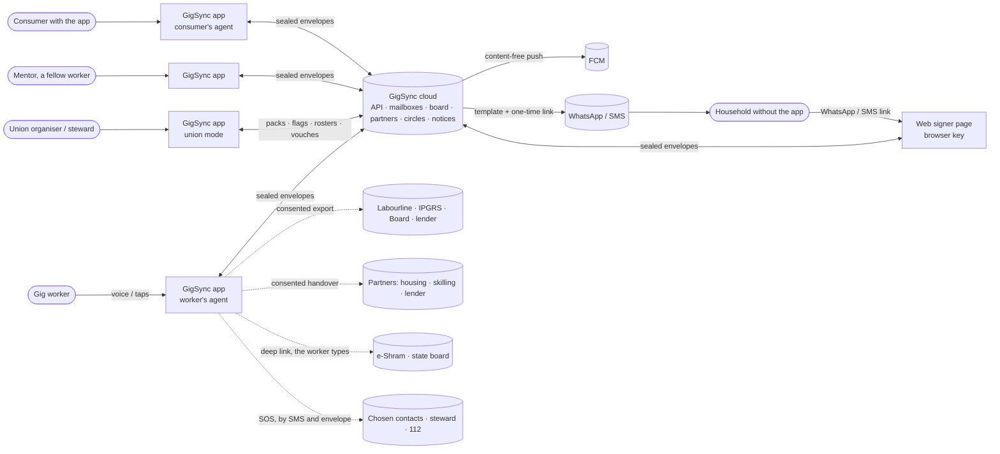

| Actor                                      | Uses                                       | Sees                                                                                                                     |
| ------------------------------------------ | ------------------------------------------ | ------------------------------------------------------------------------------------------------------------------------ |
| Worker                                     | Android app (web/iPhone), worker           | Everything about their own working life                                                                                  |
| Consumer with the app                      | Same app, requester role                   | Agreed terms; the worker's contact only during the job; the worker's identity tier and job count                         |
| Household without the app                  | WhatsApp or SMS link → web signer          | The terms, then the worker's contact after signing; stages to accept or dispute; a UPI link                              |
| Mentor                                     | Same app, worker, opted in to a circle     | A newcomer's landing request; contact after both accept                                                                  |
| Union organiser / steward                  | Same app in union mode (usually a browser) | Packs sent to that union; its flags; circle rosters as blind keys; partners it vouched                                   |
| Receiver (helpline, board, portal, lender) | A consented export file or form            | Only the fields of the scope the worker chose                                                                            |
| Partner                                    | Its own system; a GigSync identity         | One worker's handover at a time, with that worker's consent                                                              |
| State registry                             | Its own portal, opened by deep link        | What the worker types there; GigSync stores only the ids they get back                                                   |
| GigSync cloud                              | —                                          | Usernames, public keys, public cards, sealed envelopes, opaque slot holds, partner registry, blind rosters, template ids |

**Union mode.** The union has its own GigSync identity and keys. What reaches it is what a worker chose to send.
The organiser reads packs, drafts complaints from templates, manages members, issues flags, opens and closes
circles, approves mentors, vouches partners, and reviews city packs. They never see a worker's phone, other jobs,
rules or contacts.

## 5. Components

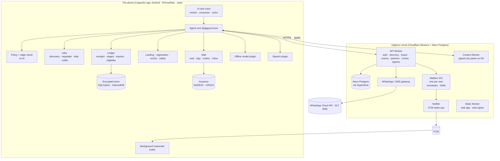

| Component              | Technology                             | Responsibility                                                                                                           | State                                |
| ---------------------- | -------------------------------------- | ------------------------------------------------------------------------------------------------------------------------ | ------------------------------------ |
| App                    | Capacitor 8, React 19, Vite            | Worker, consumer and union screens; voice UI; confirm cards; adapters for every port                                     | Built (G1 screens)                   |
| Agent core             | TypeScript, no platform imports        | Discovery, negotiation, deals, policy, edge check, ledger, stages, exports, landing, registration, circles, safety, mail | Jobs and mail built                  |
| Crypto                 | `packages/crypto`, noble               | Seal/open per device, Ed25519, terms hash, blind keys, slot keys, backup key, content verify                             | Built                                |
| Protocol               | zod, `packages/protocol`               | Every wire schema and test vector                                                                                        | Jobs and board built                 |
| Offline model          | `plugins/gigsync-llm`                  | Optional intent help and phrasing; lite mode without it                                                                  | Stubs; web built                     |
| Speech                 | `plugins/gigsync-speech`, ONNX Runtime | Kannada/Hindi/Telugu ASR and translation on device                                                                       | Planned (G3)                         |
| Encrypted store        | SQLCipher; encrypted IndexedDB on web  | Ledger, rules, audit, contacts (separate), landing, registrations, circles                                               | Planned (G1b)                        |
| Background responder   | Kotlin, FCM-woken                      | Answers routine requests with the same rules while the app is closed; safety check-in timers                             | Planned (G4)                         |
| API Worker             | Hono on Workers, Neon via Hyperdrive   | OTP sign-in, device keys, directory, board, postings, unions, flags, partners, circles, signers, notices                 | Built (auth, directory, board, mail) |
| Mailbox DO             | Durable Object (SQLite) per user       | Sealed envelopes per device until acked; **slot holds** for the user's devices (§8)                                      | Built (holds planned)                |
| Notifier               | Queue consumer                         | Content-free FCM wake-ups                                                                                                | Planned (G4)                         |
| WhatsApp / SMS gateway | Worker + provider + DLT SMS            | Utility templates with one-time links; worker menu bot with no private data; SMS fallback                                | Planned (G2)                         |
| Content Worker         | Worker + R2                            | Signed, versioned city packs: rest points, helplines, document rules, going rates, default schedules                     | Planned (G3)                         |
| Static Worker          | Workers static assets                  | The web app and the web signer page                                                                                      | Exists                               |

## 6. Discovery: how work is found

Discovery is deliberately plain. The board is a directory, not a marketplace: it never ranks, never charges, and
never carries a score. The matching happens in each agent, under its owner's rules.

### 6.1 Three ways a job starts

| Way                             | Who starts               | How                                                                                                                                                                                                               | State                                                         |
| ------------------------------- | ------------------------ | ----------------------------------------------------------------------------------------------------------------------------------------------------------------------------------------------------------------- | ------------------------------------------------------------- |
| **Consumer searches the board** | Consumer's agent         | Trade, a ~1 km area, radius, mode, availability window, max rate → cards nearest first, then soonest available. The agent sends a sealed `request` to up to 3 workers at once (a fan-out group).                  | Built (fan-out, nearest first); mode and availability planned |
| **A posting**                   | Union or vouched partner | A placement, a training batch or a shift posted by a GigSync identity. The worker's agent filters postings by the worker's rules; a tap sends `interest`, then the normal flow runs with the poster as requester. | Planned (G4)                                                  |
| **Direct**                      | Either                   | A household that already knows the worker scans the worker's card QR or opens their link; a worker's agent can also send a `request` to a known household for a repeat job.                                       | Planned (G1b)                                                 |

Platform shifts (Zomato, Urban Company, Rapido) are not discovered through GigSync; they are logged into the
record so the eligibility counter and income proof are cross-platform (ADR 0018).

### 6.2 What a card holds, and what it never holds

A worker's board card: display name, trades, a ~1 km area name and rounded coordinates, a usual rate per unit,
languages, modes offered, availability (days, hours, from date), **identity tier** (7.0), and a **count of
countersigned jobs**. Never a phone, an address, a photo, a star, a rank or free-text reviews. A consumer's
request: trade, need, when, a ~1 km area, mode and answers to the trade's questions. Never a name or a door.

### 6.3 Who decides a match

The worker's agent runs `decide()` on every incoming request: trade, area, hours, mode, minimum rate, flags,
identity tier required, capacity for the day. The consumer's agent runs its own rules: budget, radius, tier
required, availability. Neither side's limits leave its phone. The board only answers "who is nearby and says
they do this"; availability on a card is advisory and the worker's signature is the truth (§8).

### 6.4 Postings and the union's role

A posting carries the poster's identity, trade, mode, area, rate and dates, signed by the poster. Only unions and
vouched partners may post, so a posting is never a scam advert; the worker's agent shows the poster's vouch.

### 6.5 What discovery is not

No paid placement, no "featured" cards, no demand-side ranking, no recommendation model. A worker who wants to be
found more often can widen their area, add a trade or a mode, or lower their usual rate; nothing else moves them.

## 7. Flows

Every flow below runs on sealed envelopes through the mailbox unless it says otherwise; the API verifies each
envelope's signature against the sender's registered device key before accepting it (built).

### 7.0 Sign-in, device keys and identity tiers

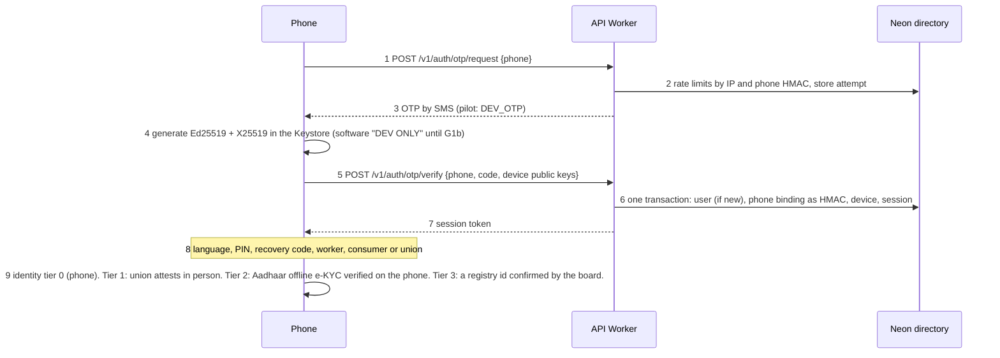

Tiers are facts the worker (or household) holds and chooses to show; the cloud stores only the tier number and the
attesting party. No character or criminal checks exist anywhere in the design.

### 7.1 Discovery and request fan-out (built)

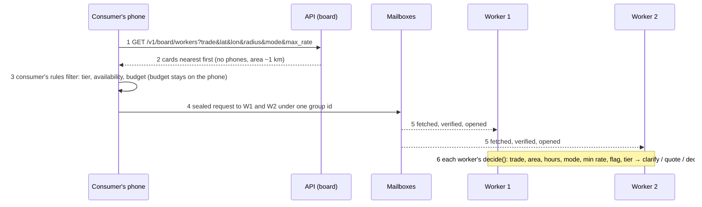

### 7.2 Negotiation and the two-signature agreement (built; concurrency in §8)

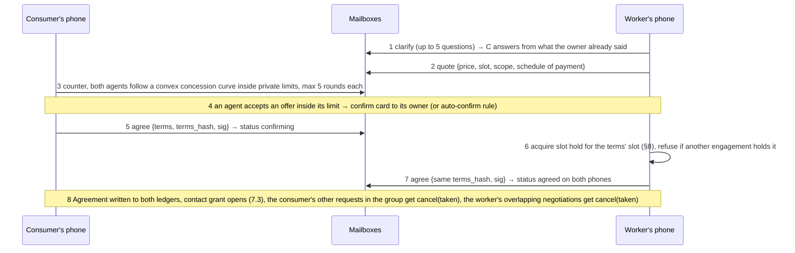

If the two `agree` envelopes carry different hashes (crossed counters), neither side reaches `agreed`; the later
one is rejected and the next quote reopens negotiation. An `agree` for a cancelled or expired engagement is
dropped.

### 7.3 Contact release and revocation

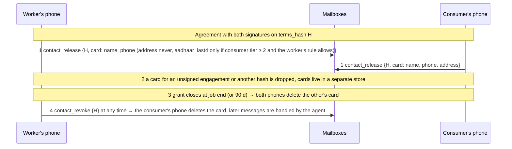

This is enforced by `decide()` with `opens_on: agreement`: the edge check refuses `phone`, `address` and
`aadhaar_last4` until the ledger holds both signatures on the same hash. The union's flag check runs on the
consumer's blind key at request time, before any grant can open.

### 7.4 Visits, stages and the ledger ([ADR 0022](../adr/0022-payment-schedules-by-day-and-stage-no-escrow.md))

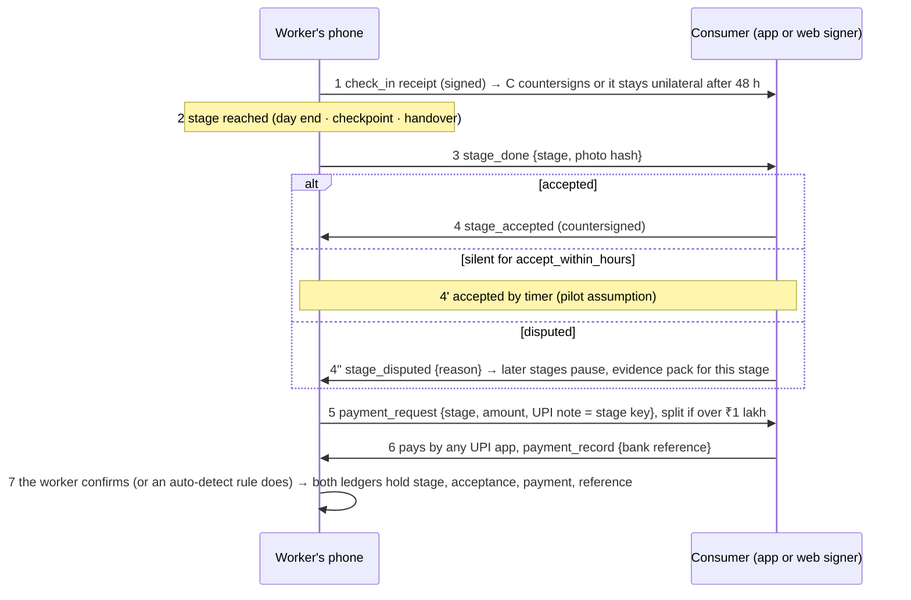

Every entry is hash-chained on the worker's phone: `entry_hash = sha256(prev || entry)`. A platform shift is a
`platform_shift` receipt the worker logs with the platform name and a statement photo; always unilateral, always
counted for eligibility, always marked self-logged on export.

### 7.5 The worker gets paid ([ADR 0011](../adr/0011-upi-qr-payments-no-gateway.md), [ADR 0012](../adr/0012-payment-auto-detect.md))

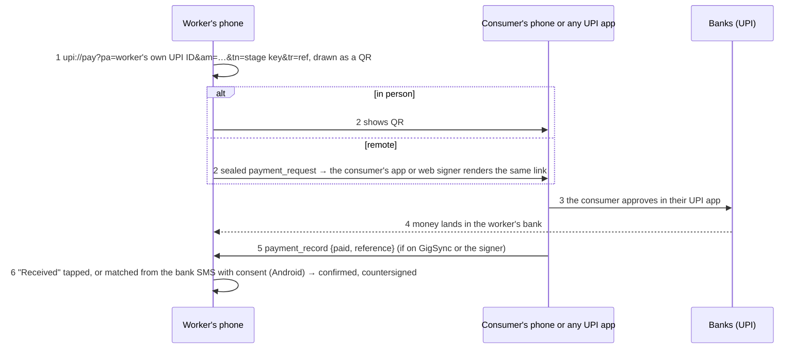

GigSync never holds, routes or sees the money, and runs no gateway.

### 7.6 Something goes wrong: evidence packs

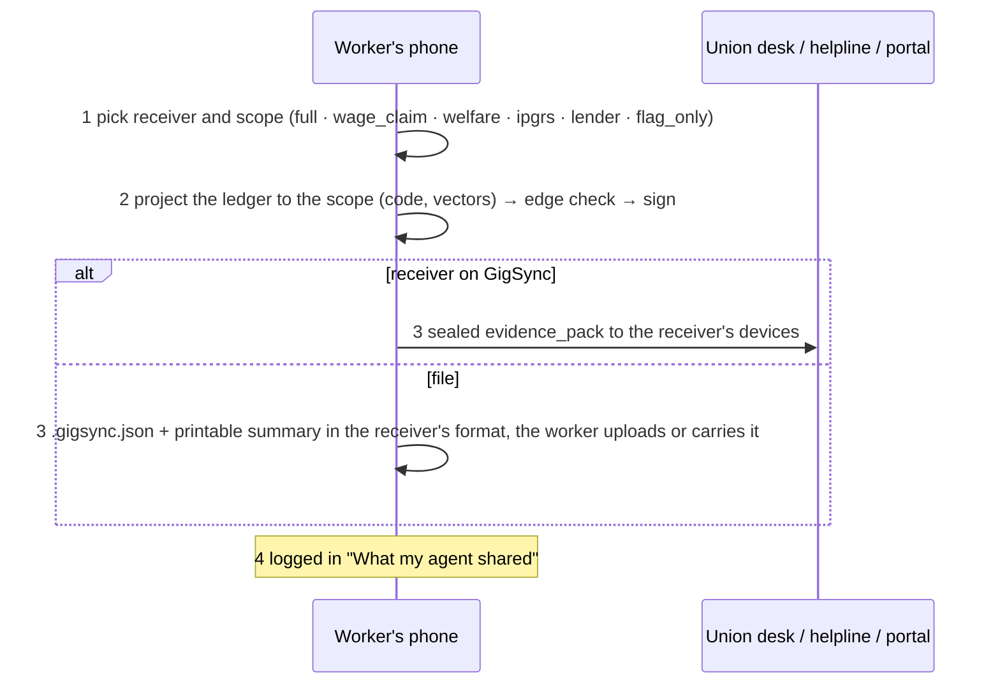

| Receiver                 | Gets                                                               |
| ------------------------ | ------------------------------------------------------------------ |
| Union grievance desk     | Full pack                                                          |
| India Labourline         | Days worked and pay owed, as a wage-claim summary                  |
| Karnataka IPGRS / IDRC   | Name, address, mobile, description, plus the pack as an attachment |
| Welfare board            | Days worked and earnings; UAN and UIN                              |
| Lender (vouched partner) | Monthly totals and countersigned share; no customer identities     |
| Fellow members' agents   | A "do not accept" flag on a customer's blind key                   |

### 7.7 Union flags

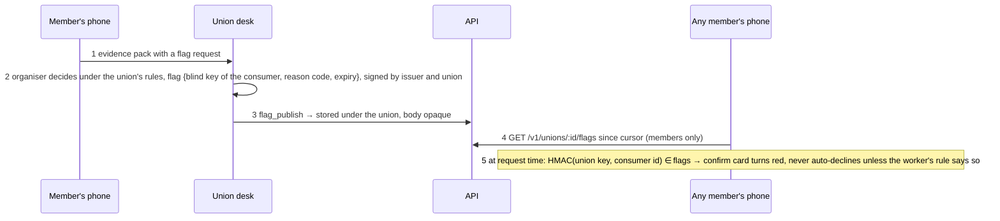

Only a reason code travels, never the complainant or their story.

### 7.8 Safety check-in and SOS (proposed; the pilot union tunes it)

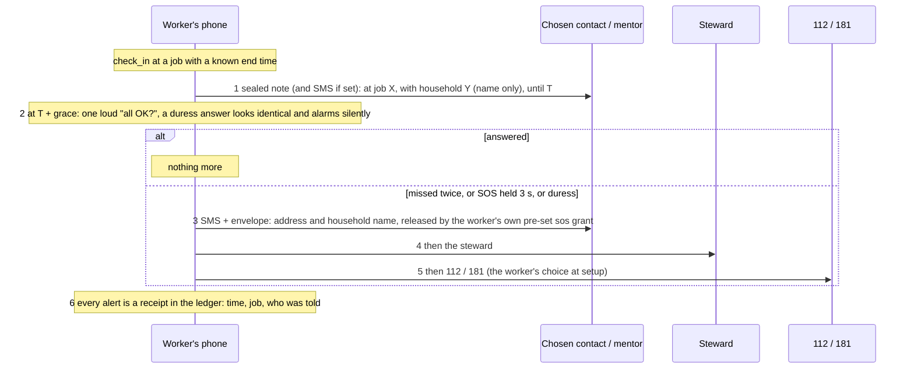

Rules: opt-in per job; no heartbeat during work, one check at the end plus one mid-point for long jobs; no
continuous location; the address goes only to people the worker chose, under a grant the worker set in advance;
nearby workers only if they opted in as responders and the steward approved them.

### 7.9 Landing in a new city ([ADR 0016](../adr/0016-landing-journey-and-partner-registry.md))

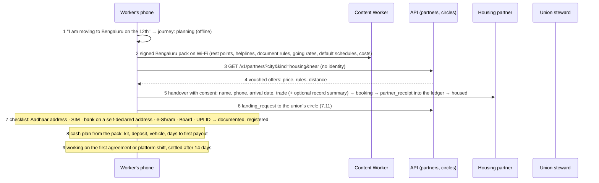

### 7.10 Registration and the eligibility counter ([ADR 0019](../adr/0019-registration-helper-and-eligibility-counter.md))

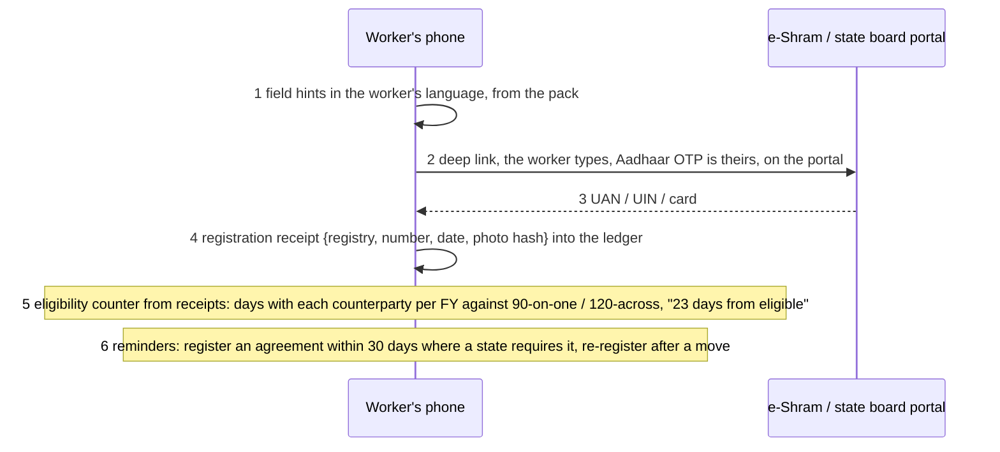

### 7.11 Circles and mentors ([ADR 0017](../adr/0017-circles-union-run-peer-groups.md))

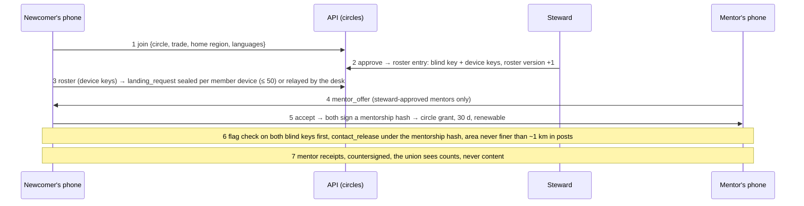

### 7.12 A partner handover

A handover is one worker's consent: a confirm card lists the exact fields; it is sealed to the partner's device or
exported as a signed file; the partner's reply lands as a `partner_receipt`; the grant expires in 30 days and can
be revoked. A partner cannot query, list or be pushed workers.

### 7.13 A household without the app ([ADR 0021](../adr/0021-whatsapp-as-a-door-never-the-agent.md))

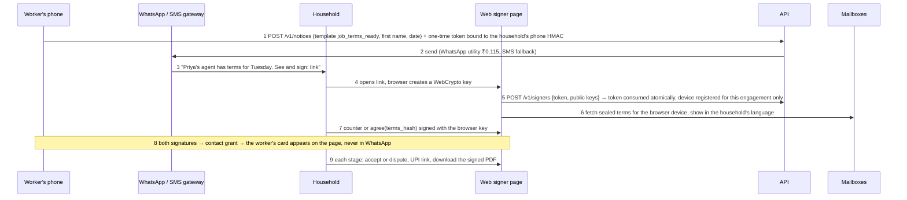

Meta and the provider see only the template text and the link. A Meta restriction cannot stop a job: SMS carries
the same link, and the record is on the phone.

### 7.14 Backup, restore, shared phone and deletion

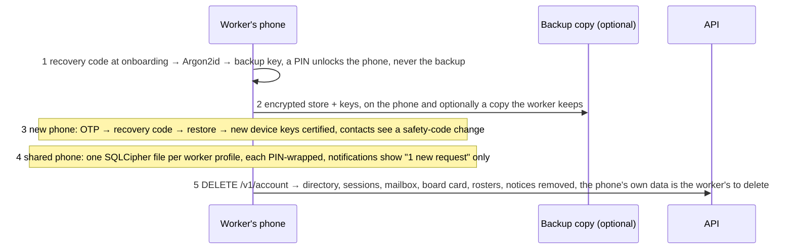

## 8. Consistency and concurrency

The rule is simple: **a booking exists only as two signatures on one terms hash, and each signature is made by
one device at a time.** Everything below exists to make that rule hold under fan-out, multiple devices, retries,
offline phones and clock skew.

### 8.1 Invariants

| Id  | Invariant                                                       | Enforced by                                                                                                                          |
| --- | --------------------------------------------------------------- | ------------------------------------------------------------------------------------------------------------------------------------ |
| I1  | A consumer's need is agreed with at most one worker             | At most one outstanding signature per need on the consumer's phone; `cancel(taken)` to the rest of the group (built)                 |
| I2  | A worker's slot is agreed with at most one consumer             | A **slot hold** acquired before the worker signs; one hold per slot; overlapping negotiations get `cancel(taken)`                    |
| I3  | `agreed` means both signatures on the same `terms_hash`         | The state machine: `confirming` on one signature, `agreed` only on the matching second; a different hash reopens negotiation (built) |
| I4  | An envelope is applied once per device, in order per engagement | Envelope ids and the mailbox `seen` table; `(engagement, seq)` with gap holding (built)                                              |
| I5  | Contact fields never cross before I3                            | `decide()` with `opens_on: agreement`; the receiving phone drops cards without a matching signed hash (built)                        |
| I6  | A payment stage is requested once and recorded once             | Stage keys in the schedule; a `payment_record` for an unaccepted stage is held; bank reference stored once                           |
| I7  | A one-time link is used once                                    | `UPDATE signer_tokens SET used_at = now() WHERE token_hash = $1 AND used_at IS NULL RETURNING …`                                     |
| I8  | A ledger is append-only and verifiable                          | Hash chain; `verifyChain` on export and restore                                                                                      |

### 8.2 No double booking of a worker

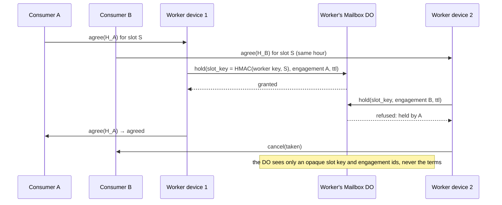

- A **slot** is the agreed time range on the terms (a visit, a day, a recurring schedule). The slot key is an
  HMAC under the worker's own key, so the cloud learns nothing about when or where.
- The Mailbox DO is single-threaded per user, so `hold` is atomic across all of a worker's devices. A hold has
  the `agree` TTL (7 days) or ends on cancel or job end.
- A phone with a single device and no network may sign without the DO; a worker with several devices must be
  online to sign (the card says "connect to confirm"). The pilot assumes one device per worker.
- Recurring work (part-time, full-time) holds the whole schedule; a conflicting request is declined by
  `decide()` as `capacity` before it ever reaches a signature.
- Availability on the board card is advisory; the hold and the signature are the truth.

### 8.3 Races the design accepts and how they end

| Race                                                            | Outcome                                                                                                                           |
| --------------------------------------------------------------- | --------------------------------------------------------------------------------------------------------------------------------- |
| Both agents send `agree` on different hashes at the same moment | Neither is `agreed`; the later-received one is rejected; a new quote reopens negotiation                                          |
| A consumer's three workers all accept                           | The first pair of matching signatures wins; the other two engagements get `cancel(taken)`                                         |
| The worker signs, then the phone dies before sending            | The outbox retries with backoff; the hold is already held; the consumer's `confirming` times out at the agree TTL and both revert |
| A `contact_release` arrives before the second `agree`           | Dropped; it is re-sent after the agreement                                                                                        |
| Duplicate delivery after a retry                                | Mailbox `seen` table; envelope id is idempotent                                                                                   |
| Envelopes out of order                                          | Held by `(engagement, seq)` until the gap fills; expired by TTL                                                                   |
| Clock skew between phones                                       | `expires_at` checked with ±5 minutes of tolerance; the API stamps delivery time                                                   |
| Two consumers pay the same stage reference                      | The stage records the first bank reference; the second `payment_record` is held for the worker to resolve                         |
| A household forwards the one-time link                          | Token bound to the phone HMAC and single use; a second open fails                                                                 |
| Two devices edit the worker's board card                        | Last write wins on `updated_at`; search reads are eventually consistent within seconds                                            |
| The steward and a member change a roster at once                | One Postgres transaction per change; the roster version is returned and posts carry the version they were sealed with             |

### 8.4 What the cloud can and cannot do

The cloud can delay or drop an envelope; it cannot forge one (signatures), read one (sealing), or create a
booking (two signatures from two phones). The mailbox hold is an availability lock, not a booking: losing the DO
loses holds, after which the worker's phone re-creates them from its own ledger.

## 9. Data placement

| What                                                  | Where                              | Who can read              | How long                                          |
| ----------------------------------------------------- | ---------------------------------- | ------------------------- | ------------------------------------------------- |
| Jobs, stages, pay, rules, audit, landing state        | The worker's phone, SQLCipher      | Only the worker           | Until the worker deletes                          |
| Registration ids, eligibility counter, tier proofs    | The worker's phone                 | Only the worker           | Until the worker deletes                          |
| Backup                                                | Their phone; an optional copy      | Only their phones         | Their choice                                      |
| Contact details shared with them                      | Their phone, separate store        | Them, during the grant    | Deleted when it ends                              |
| Messages on the way (jobs, circles, handovers, packs) | Mailbox DO                         | Nobody: sealed            | Deleted on ack, ≤ 7 d                             |
| Slot holds                                            | Mailbox DO                         | The worker's devices      | Until cancel, job end or TTL                      |
| Username, public keys, tier number                    | Neon directory                     | GigSync servers           | Life of the account                               |
| Phone number                                          | Neon, HMAC only                    | Nobody in clear           | Life of the account                               |
| Public card, postings                                 | Neon board (area rounded to ~1 km) | Anyone                    | Until withdrawn                                   |
| Partner registry and vouches                          | Neon                               | Anyone                    | Until the vouch expires                           |
| Circle rosters                                        | Neon, blind keys + device keys     | Members (keys), the union | Union's rules                                     |
| City content packs                                    | R2, signed                         | Anyone                    | Versioned                                         |
| WhatsApp / SMS notices (template, link)               | Meta Cloud API, provider, gateway  | Meta, provider, gateway   | Meta ≤ 30 d; gateway keeps template id and status |
| A household's browser key and signed terms            | The household's browser; PDF       | The household             | Until they clear the browser                      |
| Evidence pack / handover                              | The receiver the worker chose      | Only that receiver        | Receiver's rules                                  |
| Union flag list                                       | Members' phones                    | Members                   | Union's rules                                     |

## 10. Security model

- **Identity:** OTP sign-in → per-device Ed25519 and X25519 keys in the Keystore. The directory serves public
  keys; key changes are `key_change` envelopes; contacts see a safety-code change.
- **Envelopes:** XChaCha20-Poly1305 under a fresh content key, wrapped per recipient device with X25519 + HKDF,
  signed with the sender's Ed25519 key over canonical JSON; the API refuses a bad signature (built). Replay is
  stopped by `(engagement, seq)` and `expires_at`.
- **Agreements:** `terms_hash = SHA-256(canonical terms)` covering price, slot, scope, schedule of payment and
  every model-agreement field. Any change is a new agreement.
- **Threats and answers:**

| Threat                                                | Answer                                                                                         |
| ----------------------------------------------------- | ---------------------------------------------------------------------------------------------- |
| Platform or consumer tampers with records             | Both-signed ledger, hash chain                                                                 |
| Doxxing before agreement                              | Contact grant opens on the second signature; cards dropped otherwise                           |
| Prompt injection from another agent, a pack, a notice | Data not instructions; no model in the decision path; packs signed; notices are template ids   |
| Stolen phone                                          | SQLCipher + Keystore + PIN; backup needs the recovery code                                     |
| Shared phone                                          | Per-worker store and key                                                                       |
| Server compromise                                     | Sealed envelopes, HMAC'd phones, opaque holds, blind rosters                                   |
| Flag abuse                                            | Union-governed issuers, signed flags, expiry, reason codes only                                |
| Double booking, replay, duplicates                    | §8                                                                                             |
| Fake partner or purchasable vouch                     | Only union-signed vouches are served; no listing fees                                          |
| Predatory mentor                                      | Steward approval, flags, 30-day grant, ~1 km area only                                         |
| Partner harvesting workers                            | Partners cannot query; every handover is one consent                                           |
| Meta disabling the business number                    | SMS fallback; record on the phone; signer page reachable from any link                         |
| Bot coaxed into echoing private data                  | The menu bot holds none; no model behind it                                                    |
| Household disputing every stage to delay pay          | Later stages pause; each stage has its own countersigned evidence; pack to union or Labourline |
| Worker claiming a stage not done                      | Photo hash and the household's accept or dispute both in the record                            |
| Forwarded one-time link                               | Token bound to the phone HMAC, single use                                                      |
| Abuser silences the safety check-in                   | Duress answer; escalation to chosen contacts by SMS                                            |
| Harm by an unflagged customer at the job              | Not solved by software; identity tiers, first-visit rules and the union are the answer         |
- **Compliance:** DPDP Act consent, correction and erasure; `consents` table; `DELETE /v1/account`; no Aadhaar
  number ever stored in the cloud or sent in a chat.

## 11. Non-functional targets

| Attribute      | Target                                                                                        |
| -------------- | --------------------------------------------------------------------------------------------- |
| Device         | Android 10+, 4 GB RAM, 32 GB storage; works with 0 models installed                           |
| App size       | < 30 MB without models; language packs 130–300 MB on Wi-Fi only                               |
| City pack      | < 2 MB per city, fully offline                                                                |
| Latency        | Policy decision < 50 ms; delivery p95 < 5 s online; hold acquisition p95 < 1 s                |
| Offline        | Ledger, rules, drafting, landing checklist, city guide and single-device signing work offline |
| Circles        | Fan-out ≤ 50 devices from a phone; larger circles relay via the desk                          |
| Notices        | ≤ ₹1.5 per job; a job completes with zero notices delivered                                   |
| Availability   | Cloud 99.5% (pilot); envelopes durable until ack or TTL                                       |
| Battery / data | < 2% battery/day idle; < 5 MB/day data without model or pack downloads                        |
| Privacy        | Zero readable private data in the cloud; verified by a data-flow test                         |

## 12. Milestones

| Milestone | Scope                                                                                                                                                                                                                                                                       |
| --------- | --------------------------------------------------------------------------------------------------------------------------------------------------------------------------------------------------------------------------------------------------------------------------- |
| G0        | Rename, docs, ADRs (done); v1.0 docs (this)                                                                                                                                                                                                                                 |
| G1a       | Merge PR #7 and #8: Neon directory, agent-to-agent jobs, board, contact release, UPI payment, signatures                                                                                                                                                                    |
| G1b       | Ledger, receipts, platform-shift receipts, payment schedules and stage receipts, slot holds in the DO, SQLCipher store and Keystore keys; terms gain mode, schedule, leave, notice; Kannada templates; reviews replaced by countersigned "worked together"; direct requests |
| G2        | Registration helper, eligibility counter; evidence packs and exports; union mode (web); WhatsApp/SMS door and web signer; identity tiers 1–2; safety check-in                                                                                                               |
| G3        | Landing: city packs, partner registry, housing handover, documents checklist, cash plan; voice on device; shared-phone mode                                                                                                                                                 |
| G4        | Circles and mentors; postings; notifier and background responder; flag governance                                                                                                                                                                                           |
| G5        | **Pilot:** 50 service workers with one Bengaluru union; 10 newcomers landed; packs filed; measures in VISION §9                                                                                                                                                             |
| G6        | Lender scope and income proof; skilling partners; second city and language set; tier 3 via a board contract                                                                                                                                                                 |

## 13. Open questions

1. Which union, by name, with what MoU.
2. Will a receiver (Labourline, IDRC, Board, NBFC) accept a both-signed worker-held record, and in what format.
3. Consumer identity tier required before Aadhaar last 4 can appear on a worker's card (default: tier 2).
4. Does Karnataka's Domestic Workers Bill pass in a form that recognises a phone-signed agreement.
5. Which housing partner first, and on what terms for the worker.
6. How a worker with no bank account is paid and recorded (cash receipts are allowed and unverifiable).
7. Which phone-class model ships first; does any Indic speech model run on a 4 GB phone.
8. Who issues flags and approves mentors.
9. Minimum evidence a helpline accepts from a unilateral or platform-shift receipt.
10. Should 24 hours of silence count as acceptance of a stage.
11. Is person-to-person UPI outside payment-aggregator rules; is an agent that agrees jobs through a board an "aggregator" under the Code and the Karnataka Act.
12. Multi-device workers: keep the one-device pilot assumption, or ship the online-only signing rule from day one.
