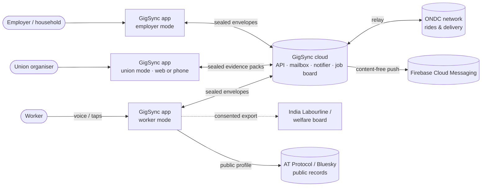
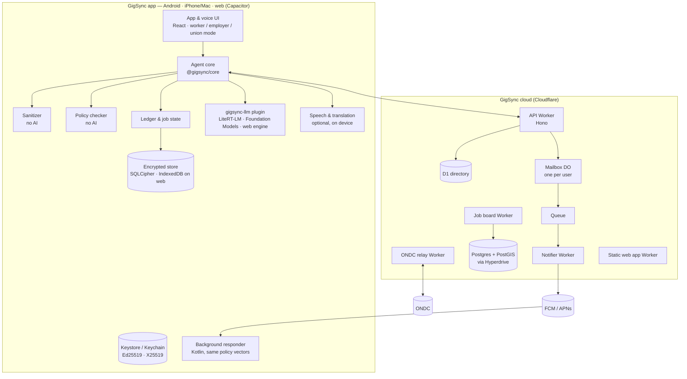

# GigSync — High-Level Design (HLD)

> Status: **draft v0.1, 25 Oct 2026.** Planned design; most of it is not built yet. GigSync is a working name.
> Companion documents: [LLD.md](LLD.md) (components, schemas, APIs) and the decision records in
> [`docs/adr/`](../adr/). This repo started as a copy of
> [collabai.network](https://github.com/kirav5/collabai.network) (remote `upstream`), and GigSync reuses its
> agent core, protocol, mailbox and policy engine.

## 1. Summary

GigSync gives a gig worker **her own agent, on her own phone**. The agent:
1. **Agrees the job first.** Her agent and the employer's agent settle rate, hours, weekly off and leave, under
   rules she sets.
2. **Holds back her contact.** Her number, address and Aadhaar are released only after both phones sign the same
   terms, and only until the job ends.
3. **Keeps the record.** Every job, visit and payment is signed by both phones and stays with her. She decides
   which part a union, a wage helpline or a welfare board sees.

The thesis, carried over from Collab: with local agent-to-agent messaging, _the weaker party to a transaction
holds the record of it_. The cloud only passes locked notes.

**Who we start with:** women service workers in India, in domestic work, beauty and home services. Both the data
problem and the safety problem are worst there. Delivery and rides (through ONDC), construction and home-based
piece work come later on the same core.

## 2. Goals and non-goals

| Goals                                                                  | Non-goals (v1)                                    |
| ---------------------------------------------------------------------- | ------------------------------------------------- |
| Runs on a 4 GB, ₹10,000 Android phone on patchy 4G                     | iPhone-first, or flagship-only features           |
| Works with **no model at all**; models only help with speech and words | Any frontier or cloud LLM in the core path        |
| A worker-held signed ledger of jobs and payments                       | A central database of workers that she cannot see |
| Contact released only after both sides sign; it expires                | Payments rails (UPI is recorded, not moved)       |
| Consented, partial exports to a union, helpline or welfare board       | Ratings or ranking of workers by GigSync          |
| Voice first in Hindi, Telugu and Hinglish                              | Full literacy-dependent UI                        |
| Shared-phone mode: one device, a separate locked store per worker      | Multi-tenant SaaS for platforms                   |
| Open formats and test vectors that others can implement                | Lock-in through proprietary formats               |

## 3. Design principles

1. **Models propose, code decides.** The policy checker is plain rules (`decide()`). It never calls a model.
2. **A message from another agent is data, never an instruction.**
3. **Private data never leaves the phone readable.** Envelopes are sealed on the sender's phone, for the
   recipient's devices only.
4. **Sanitize before any model.** Aadhaar, PAN, UPI, phone, card and similar numbers become placeholders such as
   `AADHAAR_1` before any model, even the phone's own, sees the text.
5. **She sees every disclosure.** "What my agent shared" lists each fact, the receiver and the rule that allowed it.
6. **Small and replaceable.** Every model sits behind a port and can be swapped or removed.
7. **Collective governance where it is collective.** Her union decides what a shared "do not accept" flag means
   and who may raise one.

## 4. Actors and context



| Actor                    | Uses                             | Sees                                                      |
| ------------------------ | -------------------------------- | --------------------------------------------------------- |
| Worker                   | Android app (web/iPhone), worker | Everything about her own working life                     |
| Employer / household     | Same app, employer mode          | Agreed terms; her contact only during the job             |
| Union organiser          | Same app, union mode (web/phone) | Evidence packs the worker sent to the union, nothing else |
| Union sisters' agents    | Their own phones                 | A "do not accept this customer" flag, never her story     |
| Helpline / welfare board | A consented export file          | Days worked and pay (owed), only the fields she picked    |
| GigSync cloud            | —                                | Usernames, public keys, public profiles, locked envelopes |

## 5. One app, every platform, an offline model

GigSync is **one TypeScript codebase** (Capacitor + React, ADR 0001), inherited from collabai.network. It ships as
an Android app, an iPhone/Mac app and a **web app** from the same source. Workers, employers and union organisers
use the same app in different modes; the union desk is simply the app in **union mode**, usually in a browser.

The language model is the **offline, on-device model plugin collabai.network already has**
(`plugins/gigsync-llm`, formerly `plugins/collab-llm`). It is one Capacitor plugin, `GigSyncLLM`, with
`status()` and `generate()`, and a native engine per platform:

| Platform       | Engine                                                | State today                       |
| -------------- | ----------------------------------------------------- | --------------------------------- |
| Android        | LiteRT-LM (Kotlin), a ≤2B open model                  | Stub returns "no model"           |
| iPhone and Mac | Apple Foundation Models (Swift), on-device            | Stub returns "no model"           |
| Web            | In-browser engine behind `GigSyncLLMWeb` (WebGPU)     | Returns "no model"; templates run |
| Development    | Ollama adapter (`VITE_OLLAMA_MODEL`), dev builds only | Exists                            |

Every engine is optional. When `status()` reports no model, or too little free memory, the agent runs in **lite
mode**: the keyword router and fixed templates cover every path. Nothing in GigSync calls a cloud model
([ADR 0010](../adr/0010-no-cloud-model-in-gigsync.md)). We do not use Tiles or Tilekit: Tiles runs only on Apple
Silicon Macs and Linux, and GigSync must run on phones and in the browser
([ADR 0009](../adr/0009-one-offline-model-plugin-not-tilekit.md)).

## 6. Containers



| Container            | Technology                                                | Responsibility                                                                           |
| -------------------- | --------------------------------------------------------- | ---------------------------------------------------------------------------------------- |
| GigSync app          | Capacitor 8, React 19, Vite; Android, iPhone/Mac, web     | Worker, employer and union modes; voice UI; confirm cards                                |
| Agent core           | TypeScript, no platform imports (`packages/core`)         | Router, experts, job machine, policy, sanitizer, ledger, mail                            |
| Protocol             | zod schemas (`packages/protocol`)                         | Envelopes, job terms, receipts, grants, evidence packs, public records                   |
| Offline model        | `plugins/gigsync-llm`: LiteRT-LM, Foundation Models, web  | Optional intent help and phrasing; lite mode without it                                  |
| Speech / translation | IndicConformer (ASR), IndicTrans2-dist (MT), ONNX Runtime | Speech in and translation, optional and on device                                        |
| Encrypted store      | SQLCipher (native), encrypted IndexedDB (web)             | Ledger, rules, audit, keys metadata, shared-context store                                |
| Background responder | Kotlin, FCM-woken                                         | Answers routine requests while the app is closed, using the same rules                   |
| API Worker           | Cloudflare Workers + Hono + D1                            | OTP sign-in, device keys, directory, rate limits, mailbox front door                     |
| Mailbox DO           | Durable Object (SQLite) per user                          | Holds sealed envelopes per device until acked, then deletes them                         |
| Notifier             | Queue consumer Worker                                     | Sends content-free FCM wake-ups                                                          |
| Job board            | Worker + Postgres/PostGIS                                 | Public profiles and open jobs, searchable by area and skill                              |
| ONDC relay           | Worker                                                    | Bridges ONDC ride/delivery jobs to worker agents (a phone cannot be an ONDC participant) |
| Web app host         | Static-assets Worker (`gigsync-app`)                      | Serves the web build of the same app                                                     |

On the web, the store and keys use WebCrypto (non-extractable keys) and an encrypted IndexedDB; a browser session
is treated as a lower-trust device and never runs the background responder.

## 7. Key flows

### 7.1 A job is agreed

```mermaid
sequenceDiagram
  participant EP as Employer's phone
  participant MB as Mailbox (DO)
  participant N as Notifier
  participant WP as Worker's phone
  EP->>MB: 1 sealed job_request (hours, area; no name/number)
  MB->>N: 2 wake-up queued
  N->>WP: 3 FCM push, no content
  WP->>MB: 4 fetch, verify signature, unseal
  Note over WP: 5 sanitizer → policy checker → her tap (or standing rule)
  WP->>MB: 6 sealed job_offer / counter
  MB->>EP: 7 delivered, then deleted
  EP->>MB: agree(terms_hash) signed
  MB->>WP: agree
  Note over EP,WP: 8 both sign the same terms_hash and write it to their own ledgers;<br/>contact grant opens now and closes at job end
```

### 7.2 A visit and payment are recorded

Each visit (check-in, check-out) and each payment is a `receipt` envelope countersigned by the other phone.
If the other side does not countersign within 48 h, it stays in her ledger as **unilateral** and is still
exportable, marked as such.

### 7.3 Something goes wrong

She picks a receiver and the scope. The phone builds an **evidence pack**: the signed agreement, receipts and her
own notes, sanitized according to the receiver's scope. It is sealed for the receiver only:

| Receiver              | Gets                                        |
| --------------------- | ------------------------------------------- |
| Union grievance desk  | Full evidence pack (for an ID block)        |
| India Labourline      | Days worked and pay owed (for a wage claim) |
| Welfare board         | Days worked and earnings only               |
| Union sisters' agents | A "do not accept" flag on a customer key    |

### 7.4 Pre-acceptance safety check

Before she accepts a job, her policy checker looks up the customer's **blind key** (a keyed hash of the
employer's GigSync id) in the flag list she receives from her union. A match turns the confirm card red. She
always decides; a flag never auto-declines unless she set a rule that says so.

## 8. Data placement

| What                             | Where                        | Who can read          | How long             |
| -------------------------------- | ---------------------------- | --------------------- | -------------------- |
| Jobs, pay, ratings, rules, audit | Her phone, SQLCipher         | Only her              | Until she deletes    |
| Backup                           | Her phone; optional copy     | Only her phones       | Her choice           |
| Contact details shared with her  | Her phone, separate store    | Her, during the grant | Deleted when it ends |
| Messages on the way              | Mailbox DO                   | Nobody: sealed        | Deleted on ack, ≤7 d |
| Username, public keys            | D1 directory                 | GigSync servers       | Life of the account  |
| Phone number                     | D1 as HMAC only              | Nobody in clear       | Life of the account  |
| Public profile, open jobs        | Job board + AT Protocol repo | Anyone                | Until withdrawn      |
| Evidence pack                    | The receiver she chose       | Only that receiver    | Receiver's rules     |
| Union flag list                  | Members' phones              | Members               | Union's rules        |

The optional off-phone backup is encrypted with a key derived from a **recovery code** she keeps; a short PIN
never protects anything stored off the phone (ADR 0007).

## 9. Security model

- **Identity:** OTP sign-in → per-device Ed25519 (signing) and X25519 (encryption) keys in the Android Keystore.
  The directory serves devices' public keys; key changes are `key_change` envelopes, and contacts see a
  safety-code change.
- **Envelopes:** XChaCha20-Poly1305 under a fresh content key, wrapped per recipient device with X25519, signed
  with the sender's Ed25519 device key over canonical JSON. Replay is stopped by `(engagement, seq)` and
  `expires_at`.
- **Agreements:** identified by `terms_hash = SHA-256(canonical terms)`. Any change to rate or hours is a new
  agreement.
- **Threats addressed:** platform or employer tampering with records (both-signed ledger), doxxing before
  agreement (contact grant), prompt injection from the other agent (data-not-instructions, no model in the
  decision path), stolen phone (SQLCipher + Keystore + PIN), shared phone (per-worker store and key), server
  compromise (sealed envelopes, HMAC'd phones), flag abuse (union-governed issuers, signed flags, expiry).
- **Compliance:** India's DPDP Act consent, correction and erasure rights. Most erasure is simply deleting data on
  her own phone; the cloud keeps a `consents` table.

## 10. Non-functional targets

| Attribute      | Target                                                                       |
| -------------- | ---------------------------------------------------------------------------- |
| Device         | Android 10+, 4 GB RAM, 32 GB storage; works with 0 models installed          |
| App size       | < 30 MB without models; each language pack ~130 MB, downloaded on Wi-Fi      |
| Latency        | Policy decision < 50 ms; message delivery p95 < 5 s when online              |
| Offline        | Ledger, rules and drafting work offline; outbox retries with backoff ≤10 min |
| Availability   | Cloud 99.5% (pilot); envelopes durable until ack or TTL                      |
| Battery / data | < 2% battery/day idle; < 5 MB/day data without model downloads               |
| Privacy        | Zero readable private data in the cloud; verified by a data-flow test        |

## 11. Reuse from collabai.network

| collabai.network piece             | GigSync use                                                           |
| ---------------------------------- | --------------------------------------------------------------------- |
| `packages/protocol` envelopes, ids | Kept; new kinds and schemas for jobs, receipts, flags, evidence packs |
| Engagement state machine           | Becomes the **job** machine (adds `checked_in`, `paid`, `disputed`)   |
| Grants and `decide()`              | Kept; new topics `contact`, `rate`, `ledger`, `safety`                |
| Mailbox DO, OTP, directory         | Kept as is                                                            |
| Index Worker (Jetstream)           | Becomes the job board's public-record ingester                        |
| `plugins/collab-llm`               | Renamed `gigsync-llm`; the one offline model for every platform       |
| PII sanitizer (ADR 0008)           | Kept and extended (Verhoeff, Luhn, PAN, UPI, IFSC, voter ID, DL)      |

## 12. Milestones

| Milestone | Scope                                                                     |
| --------- | ------------------------------------------------------------------------- |
| G0        | Rebrand fork to GigSync, docs                                             |
| G1        | Job agreement end to end between two phones, contact grant, ledger        |
| G2        | Receipts, evidence packs, exports; union mode (web)                       |
| G3        | Voice (IndicConformer), translation, phrasing model; shared-phone mode    |
| G4        | Union flag lists and governance; job board; background responder          |
| G5        | Pilot: 20–50 women service workers with a partner union; ONDC relay spike |

## 13. Open questions

1. Which phone-class model ships first on Android (≤2B, Apache 2.0), and which in-browser engine for the web?
2. Who issues flags: any member, or only union-verified organisers? (Test with the pilot union.)
3. What is the minimum evidence a helpline accepts from a unilateral (not countersigned) receipt?
4. Should employer mode require KYC, given that her safety depends on being able to identify the employer later?
5. How much of the ledger should the web build hold, given that browser storage can be cleared?
