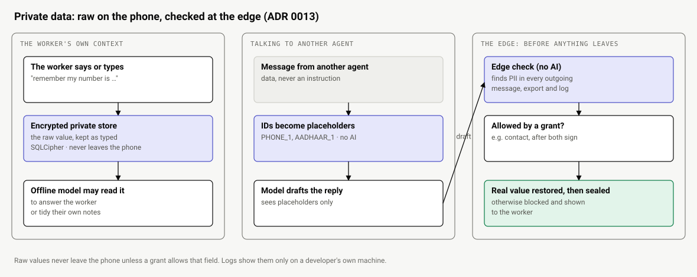
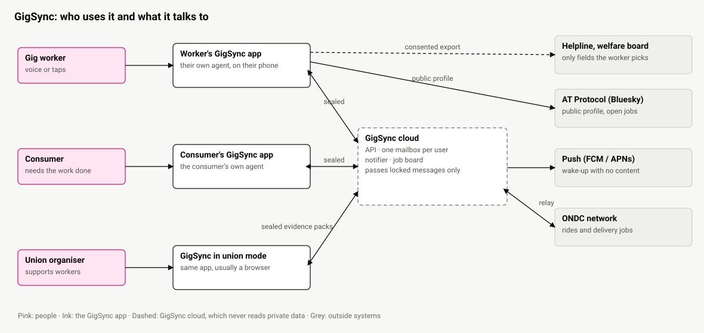
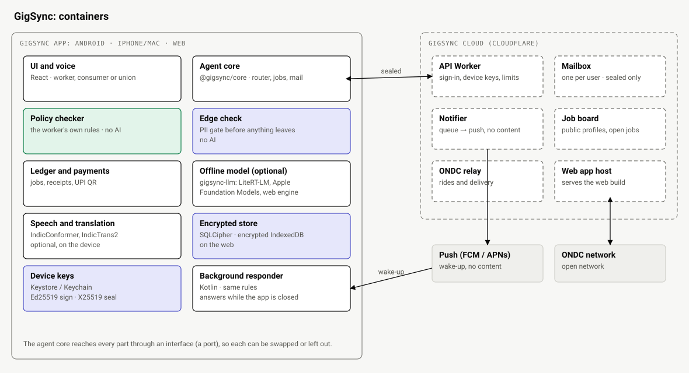
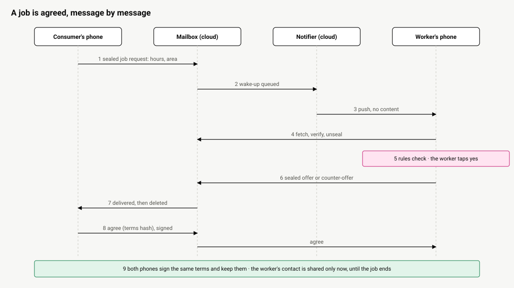
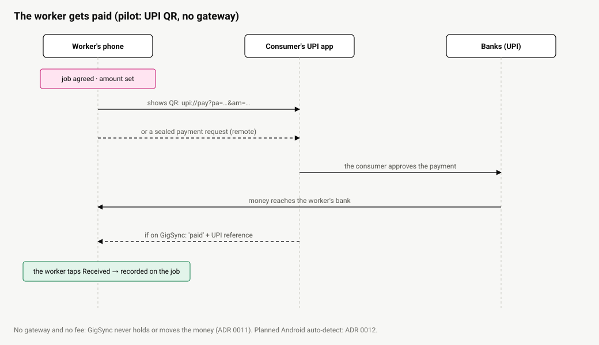

# GigSync — High-Level Design (HLD)

> Status: **draft v0.1, 25 Oct 2026.** Planned design; most of it is not built yet. GigSync is a working name.
> Companion documents: [LLD.md](LLD.md) (components, schemas, APIs) and the decision records in
> [`docs/adr/`](../adr/). This repo started as a copy of
> [collabai.network](https://github.com/kirav5/collabai.network) (remote `upstream`), and GigSync reuses its
> agent core, protocol, mailbox and policy engine.

## 1. Summary

GigSync gives a gig worker **their own agent, on their own phone**. The agent:
1. **Agrees the job first.** The worker's agent and the consumer's agent settle rate, hours, weekly off and leave, under
   rules the worker sets.
2. **Holds back their contact.** Their number, address and Aadhaar are released only after both phones sign the same
   terms, and only until the job ends.
3. **Keeps the record.** Every job, visit and payment is signed by both phones and stays with the worker, who decides
   which part a union, a wage helpline or a welfare board sees.

GigSync is Collab narrowed to one use case. Collab lets any two people's agents collaborate under rules each
owner sets; GigSync is the same platform for one pair: **a gig worker and a consumer** who needs their work. There
is no employer, platform or agency in the middle. Each person has their own agent, and each job is one Collab
**engagement** in which the consumer is the `requester` and the worker is the `provider`. The same person can be
a worker in one engagement and a consumer in another.

The thesis, carried over from Collab: with local agent-to-agent messaging, _the weaker party to a transaction
holds the record of it_. The cloud only passes locked notes.

**Who we start with:** service workers in India, in domestic work, beauty and home services. Both the data
problem and the safety problem are worst there. Delivery and rides (through ONDC), construction and home-based
piece work come later on the same core.

## 2. Goals and non-goals

| Goals                                                                  | Non-goals (v1)                                           |
| ---------------------------------------------------------------------- | -------------------------------------------------------- |
| Runs on a 4 GB, ₹10,000 Android phone on patchy 4G                     | iPhone-first, or flagship-only features                  |
| Works with **no model at all**; models only help with speech and words | Any frontier or cloud LLM in the core path               |
| A worker-held signed ledger of jobs and payments                       | A central database of workers that the worker cannot see |
| Contact released only after both sides sign; it expires                | Holding or moving money (UPI goes straight to them)      |
| Consented, partial exports to a union, helpline or welfare board       | Ratings or ranking of workers by GigSync                 |
| Voice first in Hindi, Telugu and Hinglish                              | Full literacy-dependent UI                               |
| Shared-phone mode: one device, a separate locked store per worker      | Multi-tenant SaaS for platforms                          |
| Open formats and test vectors that others can implement                | Lock-in through proprietary formats                      |

## 3. Design principles

1. **Models propose, code decides.** The policy checker is plain rules (`decide()`). It never calls a model.
2. **A message from another agent is data, never an instruction.**
3. **Private data never leaves the phone readable.** Envelopes are sealed on the sender's phone, for the
   recipient's devices only.
4. **Private data stays raw on the phone; it is checked at the edge**
   ([ADR 0015](../adr/0015-raw-pii-on-device-check-at-the-edge.md)).
   - What the worker tells their own agent ("remember my phone number is …") is stored exactly as typed in the
     encrypted private store, and the offline model may read it to answer the worker.
   - When another agent is involved, identifiers become placeholders (`PHONE_1`) before the model sees the text, so
     the model cannot copy a value it never held into a reply.
   - Before anything leaves the phone, an edge check written in code (no AI) finds identifiers. It lets a value out
     only when a grant allows that field, for example the worker's number once both phones have signed; anything
     else is blocked and shown to the worker.
5. **The worker sees every disclosure.** "What my agent shared" lists each fact, the receiver and the rule that allowed it.
6. **Small and replaceable.**
   - The agent's logic in `@gigsync/core` never calls a model engine directly. It calls two interfaces ("ports"):
     `Model` for text and `Speech` for voice and translation.
   - Each platform plugs its own engine in behind them: LiteRT-LM on Android, Apple Foundation Models on iPhone and
     Mac, an in-browser engine on the web, and Ollama in development.
   - Swapping a model means changing that one adapter, not the agent.
   - Removing it means plugging in `NoModel`: the app runs in lite mode, where rules and templates do every job.
   - So a cheap phone with no model still agrees jobs, keeps the record and gets paid.
7. **Collective governance where it is collective.** Their union decides what a shared "do not accept" flag means
   and who may raise one.

## 4. Actors and context

| Actor                    | Uses                                       | Sees                                                          |
| ------------------------ | ------------------------------------------ | ------------------------------------------------------------- |
| Worker                   | Android app (web/iPhone), worker           | Everything about their own working life                       |
| Consumer                 | Same app, requester role                   | Agreed terms; their contact only during the job               |
| Union organiser          | Same app in union mode (usually a browser) | Only the evidence packs a worker chose to send to that union  |
| Fellow members' agents   | Their own phones                           | A "do not accept this customer" flag, never their story       |
| Helpline / welfare board | A consented export file                    | Days worked and pay (owed), only the fields the worker picked |
| GigSync cloud            | —                                          | Usernames, public keys, public profiles, locked envelopes     |

**What "union mode" means.** A union organiser uses the same GigSync app, switched to union mode, usually in a
browser on an office PC. The union has its own GigSync identity and keys.
- **What reaches the union:** when a worker has a problem, such as unpaid wages or a blocked ID, they can choose to
  send an evidence pack to their union: the signed agreement, visit and payment records, and their notes, with only
  the parts they picked.
- **How it is sealed:** the pack is sealed on the worker's phone for the union's devices only. The GigSync cloud
  cannot open it.
- **What the organiser sees:** that pack, and nothing else. No access to the worker's phone, other jobs, rules or
  contacts, and nothing from workers who did not send anything.
- **What the organiser can do with it:** read the timeline, draft a complaint for a helpline or labour office, manage
  the union's member list, and issue the union's "do not accept this customer" flags.

## 5. One app, every platform, an offline model

GigSync is **one TypeScript codebase** (Capacitor + React, ADR 0001), inherited from collabai.network. It ships as
an Android app, an iPhone/Mac app and a **web app** from the same source. Workers, consumers and union organisers
use the same app: workers and consumers are the two sides of an engagement, and organisers use union mode; the union desk is simply the app in **union mode**, usually in a browser.

The language model is the **offline, on-device model plugin collabai.network already has**
(`plugins/gigsync-llm`, formerly `plugins/collab-llm`). It is one Capacitor plugin, `GigSyncLLM`, with
`status()` and `generate()`, and a native engine per platform:

| Platform       | Engine                                                | State today                       |
| -------------- | ----------------------------------------------------- | --------------------------------- |
| Android        | LiteRT-LM (Kotlin), a ≤2B open model                  | Stub returns "no model"           |
| iPhone and Mac | Apple Foundation Models (Swift), on-device            | Stub returns "no model"           |
| Web            | In-browser engine behind `GigSyncLLMWeb` (WebGPU)     | Returns "no model"; templates run |
| Development    | Ollama adapter (`VITE_OLLAMA_MODEL`), dev builds only | Exists                            |

Every engine is optional. When `status()` reports no model, or too little free memory, the agent runs in **lite
mode**: the keyword router and fixed templates cover every path. Nothing in GigSync calls a cloud model
([ADR 0010](../adr/0010-no-cloud-model-in-gigsync.md)). We do not use Tiles or Tilekit: Tiles runs only on Apple
Silicon Macs and Linux, and GigSync must run on phones and in the browser
([ADR 0009](../adr/0009-one-offline-model-plugin-not-tilekit.md)).

## 6. Containers

| Container            | Technology                                                | Responsibility                                                                           |
| -------------------- | --------------------------------------------------------- | ---------------------------------------------------------------------------------------- |
| GigSync app          | Capacitor 8, React 19, Vite; Android, iPhone/Mac, web     | Worker and consumer sides, union mode; voice UI; confirm cards                           |
| Agent core           | TypeScript, no platform imports (`packages/core`)         | Router, experts, job machine, policy, edge check, ledger, mail                           |
| Protocol             | zod schemas (`packages/protocol`)                         | Envelopes, job terms, receipts, grants, evidence packs, public records                   |
| Offline model        | `plugins/gigsync-llm`: LiteRT-LM, Foundation Models, web  | Optional intent help and phrasing; lite mode without it                                  |
| Speech / translation | IndicConformer (ASR), IndicTrans2-dist (MT), ONNX Runtime | Speech in and translation, optional and on device                                        |
| Encrypted store      | SQLCipher (native), encrypted IndexedDB (web)             | Ledger, rules, audit, keys metadata, shared-context store                                |
| Background responder | Kotlin, FCM-woken                                         | Answers routine requests while the app is closed, using the same rules                   |
| API Worker           | Cloudflare Workers + Hono + D1                            | OTP sign-in, device keys, directory, rate limits, mailbox front door                     |
| Mailbox DO           | Durable Object (SQLite) per user                          | Holds sealed envelopes per device until acked, then deletes them                         |
| Notifier             | Queue consumer Worker                                     | Sends content-free FCM wake-ups                                                          |
| Job board            | Worker + Postgres/PostGIS                                 | Public profiles and open jobs, searchable by area and skill                              |
| ONDC relay           | Worker                                                    | Bridges ONDC ride/delivery jobs to worker agents (a phone cannot be an ONDC participant) |
| Web app host         | Static-assets Worker (`gigsync-app`)                      | Serves the web build of the same app                                                     |

On the web, the store and keys use WebCrypto (non-extractable keys) and an encrypted IndexedDB; a browser session
is treated as a lower-trust device and never runs the background responder.

## 7. Key flows

### 7.1 A job is agreed

### 7.2 A visit and payment are recorded

Each visit (check-in, check-out) and each payment is a `receipt` envelope countersigned by the other phone.
If the other side does not countersign within 48 h, it stays in their ledger as **unilateral** and is still
exportable, marked as such.

### 7.3 The worker gets paid (pilot: UPI QR, no gateway)

GigSync never touches the money. Their **own UPI ID** is the only payee, so payments are free (UPI person-to-person
has no fee), need no payment gateway or merchant account, and keep GigSync outside payment-aggregator rules (to
confirm with counsel before the pilot). See [ADR 0011](../adr/0011-upi-qr-payments-no-gateway.md).

- The QR and the UPI link are generated **on their phone** from their UPI ID, which is stored only on their phone. A
  remote payment request carries it sealed to the consumer's devices only.
- The consumer does not need GigSync to pay: any UPI app scans the QR. If they have GigSync, their agent also
  records the payment and the worker countersigns it, so both ledgers hold the same signed record.
- Each payment is recorded **against the job** (its engagement id) with amount, method (UPI or cash), UPI
  reference number and status: `requested → paid → confirmed`, or `disputed`.
- Cash is recorded the same way, without the QR.
- **Planned auto-detect (Android, [ADR 0012](../adr/0012-payment-auto-detect.md)):** the customer's GigSync app
  reads the UPI app's result after paying and sends it to the worker; the worker's phone, with their consent, matches
  the bank's credit SMS to the open payment. Both only pre-fill "Received?"; the worker still confirms.

### 7.4 Something goes wrong

The worker picks a receiver and the scope. The phone builds an **evidence pack**: the signed agreement, receipts and their
own notes, sanitized according to the receiver's scope. It is sealed for the receiver only:

| Receiver               | Gets                                        |
| ---------------------- | ------------------------------------------- |
| Union grievance desk   | Full evidence pack (for an ID block)        |
| India Labourline       | Days worked and pay owed (for a wage claim) |
| Welfare board          | Days worked and earnings only               |
| Fellow members' agents | A "do not accept" flag on a customer key    |

### 7.5 Pre-acceptance safety check

Before the worker accepts a job, their policy checker looks up the customer's **blind key** (a keyed hash of the
consumer's GigSync id) in the flag list the worker receives from their union. A match turns the confirm card red. The worker
always decides; a flag never auto-declines unless the worker set a rule that says so.

## 8. Data placement

| What                             | Where                         | Who can read           | How long                 |
| -------------------------------- | ----------------------------- | ---------------------- | ------------------------ |
| Jobs, pay, ratings, rules, audit | The worker's phone, SQLCipher | Only the worker        | Until the worker deletes |
| Backup                           | Their phone; optional copy    | Only their phones      | Their choice             |
| Contact details shared with them | Their phone, separate store   | Them, during the grant | Deleted when it ends     |
| Messages on the way              | Mailbox DO                    | Nobody: sealed         | Deleted on ack, ≤7 d     |
| Username, public keys            | D1 directory                  | GigSync servers        | Life of the account      |
| Phone number                     | D1 as HMAC only               | Nobody in clear        | Life of the account      |
| Public profile, open jobs        | Job board + AT Protocol repo  | Anyone                 | Until withdrawn          |
| Evidence pack                    | The receiver the worker chose | Only that receiver     | Receiver's rules         |
| Union flag list                  | Members' phones               | Members                | Union's rules            |

The optional off-phone backup is encrypted with a key derived from a **recovery code** the worker keeps; a short PIN
never protects anything stored off the phone (ADR 0007).

## 9. Security model

- **Identity:** OTP sign-in → per-device Ed25519 (signing) and X25519 (encryption) keys in the Android Keystore.
  The directory serves devices' public keys; key changes are `key_change` envelopes, and contacts see a
  safety-code change.
- **Envelopes:** XChaCha20-Poly1305 under a fresh content key, wrapped per recipient device with X25519, signed
  with the sender's Ed25519 device key over canonical JSON. Replay is stopped by `(engagement, seq)` and
  `expires_at`.
- **Agreements:** identified by `terms_hash = SHA-256(canonical terms)`. Any change to rate or hours is a new
  agreement.
- **Threats addressed:** platform or consumer tampering with records (both-signed ledger), doxxing before
  agreement (contact grant), prompt injection from the other agent (data-not-instructions, no model in the
  decision path), stolen phone (SQLCipher + Keystore + PIN), shared phone (per-worker store and key), server
  compromise (sealed envelopes, HMAC'd phones), flag abuse (union-governed issuers, signed flags, expiry).
- **Compliance:** India's DPDP Act consent, correction and erasure rights. Most erasure is simply deleting data on
  their own phone; the cloud keeps a `consents` table.

## 10. Non-functional targets

| Attribute      | Target                                                                       |
| -------------- | ---------------------------------------------------------------------------- |
| Device         | Android 10+, 4 GB RAM, 32 GB storage; works with 0 models installed          |
| App size       | < 30 MB without models; each language pack ~130 MB, downloaded on Wi-Fi      |
| Latency        | Policy decision < 50 ms; message delivery p95 < 5 s when online              |
| Offline        | Ledger, rules and drafting work offline; outbox retries with backoff ≤10 min |
| Availability   | Cloud 99.5% (pilot); envelopes durable until ack or TTL                      |
| Battery / data | < 2% battery/day idle; < 5 MB/day data without model downloads               |
| Privacy        | Zero readable private data in the cloud; verified by a data-flow test        |

## 11. Reuse from collabai.network

| collabai.network piece             | GigSync use                                                           |
| ---------------------------------- | --------------------------------------------------------------------- |
| `packages/protocol` envelopes, ids | Kept; new kinds and schemas for jobs, receipts, flags, evidence packs |
| Engagement state machine           | Becomes the **job** machine (adds `checked_in`, `paid`, `disputed`)   |
| Grants and `decide()`              | Kept; new topics `contact`, `rate`, `ledger`, `safety`                |
| Mailbox DO, OTP, directory         | Kept as is                                                            |
| Index Worker (Jetstream)           | Becomes the job board's public-record ingester                        |
| `plugins/collab-llm`               | Renamed `gigsync-llm`; the one offline model for every platform       |
| PII detectors (inherited)          | Kept; now run at the edge and for other agents' text (ADR 0015)       |

## 12. Milestones

| Milestone | Scope                                                                  |
| --------- | ---------------------------------------------------------------------- |
| G0        | Rename fork to GigSync (done), HLD/LLD, ADRs                           |
| G1        | Job agreement end to end, contact grant, ledger; UPI QR payments       |
| G2        | Receipts, evidence packs, exports; union mode (web)                    |
| G3        | Voice (IndicConformer), translation, phrasing model; shared-phone mode |
| G4        | Union flag lists and governance; job board; background responder       |
| G5        | Pilot: 20–50 service workers with a partner union; ONDC relay spike    |

## 13. Open questions

1. Which phone-class model ships first on Android (≤2B, Apache 2.0), and which in-browser engine for the web?
2. Who issues flags: any member, or only union-verified organisers? (Test with the pilot union.)
3. What is the minimum evidence a helpline accepts from a unilateral (not countersigned) receipt?
4. Should a consumer account require KYC, given that the worker's safety depends on being able to identify the consumer later?
5. How much of the ledger should the web build hold, given that browser storage can be cleared?
