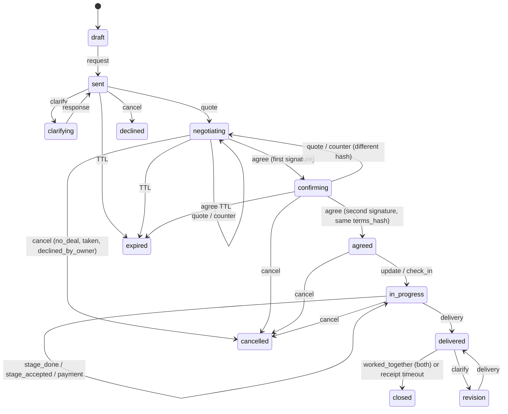
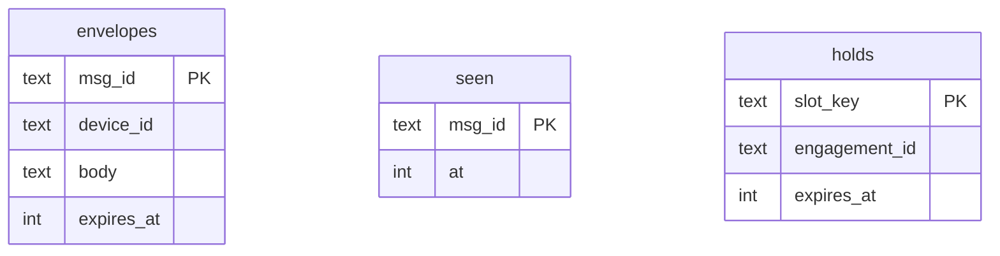
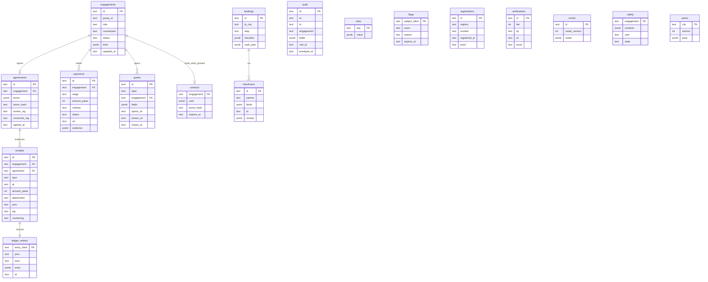

# GigSync — Low-Level Design (LLD)

> Status: **v1.0, 28 Oct 2026.** Read [VISION.md](VISION.md) and [HLD.md](HLD.md) first. States: **built**
> (merged on `main` or in [#7](https://github.com/kirav5/GigSync/pull/7), [#8](https://github.com/kirav5/GigSync/pull/8),
> [#5](https://github.com/kirav5/GigSync/pull/5)), **extended** (built, with additions here) and **planned**.
> Code follows `.claude/skills/code-quality` (files under 300 lines, schemas only in `packages/protocol`, named
> values, bound SQL, numbered migrations, `pii()` logging).

## 1. Repository layout

```text
GigSync/
├─ apps/mobile/            @gigsync/mobile     Capacitor app: Android, iPhone/Mac, web; worker, consumer, union   built, extended
├─ packages/
│  ├─ protocol/            @gigsync/protocol   zod schemas, canonical JSON, test vectors                          built, extended
│  ├─ crypto/              @gigsync/crypto     seal/open, sign/verify, terms hash; blind, backup, content keys    built, extended
│  └─ core/                @gigsync/core       discovery, jobs, policy + edge check, ledger, schedule, exports,   built, extended
│                                              landing, registration, circles, safety, notices, mail
├─ plugins/
│  ├─ gigsync-llm/         offline model: LiteRT-LM, Apple Foundation Models, in-browser engine (WebGPU)         built (stubs)
│  ├─ gigsync-speech/      Indic ASR + translation via ONNX Runtime                                              planned (G3)
│  ├─ gigsync-store/       SQLCipher + Keystore/Keychain; encrypted IndexedDB on web                             planned (G1b)
│  └─ gigsync-upi/         UPI result + SMS consent (ADR 0012)                                                   planned
├─ workers/
│  ├─ api/                 Hono: auth, directory, board, postings, mail, unions, partners, circles, signers, notices  built, extended
│  ├─ mailbox/             Mailbox Durable Object: envelopes, seen, holds                                         built, extended
│  ├─ notifier/            Queue consumer → FCM                                                                   planned (G4)
│  ├─ wa-gateway/          WhatsApp templates + menu bot, SMS fallback, one-time links (ADR 0021)                  planned (G2)
│  ├─ content/             signed city packs on R2                                                               planned (G3)
│  └─ index/               Jetstream ingester (inherited)                                                        retired (ADR 0018)
├─ android-responder/      Kotlin background responder (FCM-woken); safety timers                                planned (G4)
├─ infra/postgres/         directory, board, unions, partners, circles, signers migrations (Neon, ADR 0013)      built, extended
├─ tests/e2e, tests/ui     two-phone journeys against the API; Playwright screens                                built (PR #8)
└─ docs/{gigsync,adr}/     VISION, HLD, LLD, ROADMAP, REVENUE, ADRs
```

Dependency rule: `protocol` ← `crypto` ← `core` ← (`mobile`, workers). `core` imports nothing from Capacitor,
the browser or Workers; platforms implement its ports.

## 2. Protocol (`packages/protocol`)

All schemas are zod; every wire object is signed over `canonicalJson()`. Enumerations are zod enums and are
referred to by name in code (`Topic.enum.contact`).

### 2.1 IDs (`ids.ts`)

`<prefix>_<ULID>`. Built: `usr`, `dev`, `msg`, `eng`, `chn`, `grt`, `off`, `pay`, `ses`. Added:

| Prefix | Type              | Meaning                                                                                      |
| ------ | ----------------- | -------------------------------------------------------------------------------------------- |
| `agr`  | `AgreementId`     | One signed version of terms                                                                  |
| `rcp`  | `ReceiptId`       | Any receipt (visit, stage, payment, shift, mentor, partner, registration, sos, verification) |
| `evp`  | `EvidencePackId`  | An evidence pack                                                                             |
| `flg`  | `FlagId`          | A union "do not accept" flag                                                                 |
| `wrk`  | `WorkerProfileId` | Local profile in shared-phone mode                                                           |
| `lnd`  | `LandingId`       | One move                                                                                     |
| `ptn`  | `PartnerId`       | A partner in the registry                                                                    |
| `hnd`  | `HandoverId`      | One consented handover                                                                       |
| `cir`  | `CircleId`        | A union circle                                                                               |
| `pst`  | `PostId`          | A circle post, landing request or board posting                                              |
| `reg`  | `RegistrationId`  | A registry id the worker obtained                                                            |
| `ntc`  | `NoticeId`        | A WhatsApp or SMS notice                                                                     |
| `tok`  | `TokenId`         | A one-time signer token (stored hashed)                                                      |

### 2.2 Envelope (`envelope.ts`, built; kinds extended)

Built as in [ADR 0014](../adr/0014-agent-to-agent-jobs.md): the kinds are `quote`/`counter`/`agree`/`contact_release` rather
than the `job_*` names below, and the envelope carries `epk` and the per-device `keys` map.

```ts
EnvelopeHeader = { v: 1, id: MsgId, from: { user: UserId, device: DeviceId }, to: { user: UserId },
  engagement: EngagementId, seq: number, kind: EnvelopeKind, sent_at: ISO, expires_at: ISO, hop: 0..3 }
Envelope = { header, ciphertext: base64url, epk: base64url, keys: { [device: DeviceId]: base64url }, sig: base64url }
```

Built kinds (ADR 0014): `request | clarify | response | quote | counter | agree | contact_release | update |
delivery | cancel | receipt | key_change | payment_request | payment_record`. Removed: `review` (ADR 0020).
Added, with TTLs:

| Kind                                                                 | Direction                   | Body             | TTL  |
| -------------------------------------------------------------------- | --------------------------- | ---------------- | ---- |
| `contact_revoke`                                                     | either → other              | `{ terms_hash }` | 7 d  |
| `worked_together`                                                    | either → other, countersign | §2.4             | 7 d  |
| `stage_done` / `stage_accepted` / `stage_disputed`                   | worker ↔ consumer           | §2.3a            | 7 d  |
| `evidence_pack`                                                      | worker → receiver           | §2.6             | 7 d  |
| `flag_publish` / `flag_withdraw`                                     | union → members             | §2.7             | 30 d |
| `circle_post` / `landing_request` / `mentor_offer` / `mentor_accept` | circle members              | §2.12            | 7 d  |
| `handover` / `partner_receipt`                                       | worker ↔ partner            | §2.11            | 7 d  |
| `safety_note` / `sos`                                                | worker → chosen contacts    | §2.15            | 1 d  |
| `interest`                                                           | worker → poster (postings)  | §2.8             | 7 d  |

The engagement id is the conversation key for circles (one per circle thread), handovers (one per handover),
mentorships (one per pair) and safety notes (one per job), so the mailbox, `seq` gap holding and TTL purge are
unchanged.

### 2.3 Job bodies and terms (`job.ts`, built; extended by ADR 0018 and 0022)

Built: `Trade`, `Place`, `JobRequest`, `Clarify`, `Answers`, `Offer`, `JobTerms`, `Agree`, `ContactCard`,
`ContactRelease`, `Cancel`, `Note`, `BODY`, `MAX_ROUNDS = 5`, `MAX_QUESTIONS = 5`. Extended:

```ts
Trade = z.enum(["electrician","plumber","maid","carpenter","ac_technician","painter","cook","driver",
  "cleaner","childcare","eldercare","beautician","delivery","rider","construction","piecework"]);
WorkMode = z.enum(["one_off","part_time","full_time","platform_shift"]);
Day = z.enum(["mon","tue","wed","thu","fri","sat","sun"]);
Schedule = z.object({ days: z.array(Day).min(1), start_hour: z.number().int().min(0).max(23),
  end_hour: z.number().int().min(1).max(24), weekly_off: z.array(Day).default([]), break_minutes: z.number().int().min(0).default(0) });
Rate = z.discriminatedUnion("unit", [
  z.object({ unit: z.literal("visit"), amount_paise: Paise }),
  z.object({ unit: z.literal("hour"),  amount_paise: Paise }),
  z.object({ unit: z.literal("month"), amount_paise: Paise, paid_leave_days: z.number().int().min(0).max(31) }),
  z.object({ unit: z.literal("piece"), amount_paise: Paise, piece: z.string().max(40) }),
]);
/** The time the agreement occupies; the slot key for holds is HMAC(worker key, canonical Slot). */
Slot = z.object({ start: ISO, end: ISO, recurring: Schedule.optional() });
JobRequest += { mode: WorkMode.default("one_off"), tier_required: z.number().int().min(0).max(3).default(0) };
Offer += { slot_range: Slot, schedule_of_payment: z.array(Stage).optional() };
// Superset of the Karnataka draft Domestic Workers Bill model agreement plus the terms instant-help workers dispute.
JobTerms = z.object({
  engagement, offer_id, worker, consumer, trade, scope, slot: z.string().max(100), price_paise,   // built
  slot_range: Slot,
  mode: WorkMode.default("one_off"),
  schedule: Schedule.optional(),                     // required for part_time and full_time
  rate: Rate.optional(),                             // defaults to { unit: "visit", amount_paise: price_paise }
  duties: z.array(z.string().max(80)).max(10).default([]),
  start_date: ISODate.optional(), end_date: ISODate.optional(),
  notice_days: z.number().int().min(0).max(90).default(7),
  leave_days_per_month: z.number().int().min(0).max(31).optional(),
  absence_fine_paise: z.literal(0).default(0),       // fines are not a term GigSync carries
  waiting_paid: z.boolean().default(true),
  facilities: z.array(z.enum(["toilet","kitchen","drinking_water","rest"])).default([]),
  refusal_right: z.literal(true).default(true),
  payment_mode: z.enum(["upi","cash","bank"]).default("upi"), payment_day: z.number().int().min(1).max(31).optional(),
  schedule_of_payment: z.array(Stage).min(1).max(12), // §2.3a; default: one handover stage of 100%
  worker_tier: z.number().int().min(0).max(3), consumer_tier: z.number().int().min(0).max(3), // as shown when signed
});
TermsHash = sha256 hex of canonicalJson(JobTerms)    // built
ContactCard += { aadhaar_last4: z.string().regex(/^\d{4}$/).optional() };
```

### 2.3a Payment schedule (`schedule.ts`, planned, ADR 0022)

```ts
StageTrigger = z.enum(["advance", "day_end", "checkpoint", "handover", "timer"]);
StageEvidence = z.enum(["none", "photo", "materials_receipt", "walkthrough", "checkout"]);
Stage = z.object({
  key: z.string().regex(/^[a-z][a-z0-9_]{0,31}$/),
  label: z.string().max(60),
  trigger: StageTrigger,
  share_bps: z.number().int().min(1).max(10000).optional(),
  amount_paise: Paise.optional(), // exactly one
  evidence: StageEvidence.default("none"),
  accept_within_hours: z.number().int().min(1).max(168).default(24),
  day: z.number().int().min(1).optional(),
});
// Invariants (vectors/schedule.json): shares sum to 10000 or amounts to the price; ≤ 1 advance, ≤ 3500 bps unless the
// worker's rule allows more; day_end stages need a Schedule; keys unique.
StageDone = { stage: key, at: ISO, photo: Sha256.optional(), note: z.string().max(280).optional() };
StageAccepted = { stage: key, at: ISO, by: z.enum(["consumer", "timer"]) };
StageDisputed = {
  stage: key,
  at: ISO,
  reason: z.enum(["not_done", "not_as_agreed", "damage", "other"]),
  note: z.string().max(500),
};
```

### 2.4 Receipts (`receipt.ts`, planned)

```ts
ReceiptType = z.enum([
  "check_in",
  "check_out",
  "payment",
  "leave",
  "absence",
  "deduction",
  "platform_shift",
  "worked_together",
  "mentor",
  "partner",
  "registration",
  "stage_done",
  "stage_accepted",
  "stage_disputed",
  "materials",
  "sos",
  "safety_note",
  "verification",
]);
Receipt = z.object({
  id: ReceiptId,
  engagement: EngagementId.optional(),
  agreement: AgreementId.optional(),
  type: ReceiptType,
  at: ISO,
  amount_paise: Paise.optional(),
  hours: z.number().min(0).max(24).optional(),
  platform: z.string().max(40).optional(),
  attachment: Sha256.optional(),
  note: z.string().max(280).optional(),
  prev: Hex32,
  issuer: UserId,
  sig: Sig,
  countersig: Sig.optional(),
  countersigned_at: ISO.optional(),
});
```

`platform_shift`, `registration`, `verification`, `sos` and most `partner` receipts are unilateral by nature and
export with `unilateral: true`.

### 2.4a Payments (`payment.ts`, built; extended)

Unchanged: `Vpa`, `Paise` (≤ ₹1,00,000 per request), `PaymentMethod`, `PaymentStatus`
(`requested → paid → confirmed | disputed`), `PaymentRequest`, `PaymentRecord`, `Payment.evidence[]` (ADR 0012).
Extended: `PaymentRequest.stage` (the stage key, also in the UPI `tn` and `tr`); a stage over ₹1 lakh becomes
several requests with `part: n/m`. Only the payer records `paid`; only the payee confirms or disputes (built).

### 2.5 Grants (`grant.ts`, built; topics extended)

`Topic` gains `contact`, `rate`, `ledger`, `safety`, `circle`, `handover`, `sos`.

```ts
ContactGrant  = Grant.extend({ topic: "contact", fields: ["name"|"phone"|"address"|"aadhaar_last4"][], engagement,
  opens_on: "agreement", closes_on: "job_end"|"date", closes_at? });                       // hard cap 90 d
CircleGrant   = ContactGrant.extend({ topic: "circle", closes_on: "date" });               // 30 d, renewable
HandoverGrant = Grant.extend({ topic: "handover", partner: PartnerId, fields: HandoverField[], closes_at });   // ≤ 30 d
SosGrant      = Grant.extend({ topic: "sos", contacts: z.array(UserId | Phone).max(5), fields: ["address","household_name"],
  trigger: z.enum(["missed_twice","manual","duress"]) });                                  // set by the worker in advance
```

### 2.6 Evidence packs and exports (`evidence.ts`, planned)

```ts
Scope = z.enum(["full","wage_claim","welfare","ipgrs","lender","flag_only"]);
EvidencePack = { id, v: 1, worker, receiver: UserId | "file", scope, created_at, period: { from, to },
  agreements: Agreement[], receipts: Receipt[],
  summary: { days_worked, earned_paise, paid_paise, owed_paise, countersigned_share: 0..1 },
  registrations: Registration[], intake: { name, address, mobile, description }.optional(), notes: { at, text }[], sig };
```

| Field         | full |          wage_claim           |           welfare            |       ipgrs        |               lender                | flag_only |
| ------------- | :--: | :---------------------------: | :--------------------------: | :----------------: | :---------------------------------: | :-------: |
| agreements    |  ✓   |               ✓               |              —               |         ✓          |                  —                  |     —     |
| receipts      |  ✓   | payment, check_in/out, stages | check_in/out, platform_shift | all for the period |                  —                  |     —     |
| summary       |  ✓   |               ✓               |         days, earned         |         ✓          | monthly totals, countersigned share |     —     |
| registrations |  —   |               —               |              ✓               |         ✓          |                  —                  |     —     |
| intake        |  —   |               —               |              —               |         ✓          |                  —                  |     —     |
| notes         |  ✓   |               —               |              —               |     ✓ (chosen)     |                  —                  |     —     |
| consumer id   |  ✓   |               ✓               |              —               |         ✓          |                  —                  | blind key |

### 2.7 Union flags (`flag.ts`, planned)

```ts
Flag = {
  id: FlagId,
  union: UserId,
  subject: BlindKey /* HMAC(union_key, user_id) */,
  reason_code: z.enum(["harassment", "non_payment", "unsafe", "other"]),
  issued_by: UserId,
  issued_at,
  expires_at,
  sig,
  union_sig,
};
```

### 2.8 Board and postings (`board.ts`, built; extended)

Built: `BoardProfile` (display name, trades, ~1 km area, `area_name`, `rate_paise`, languages, about),
`BoardQuery` (trade, lat, lon, radius ≤ 50 km, max rate, limit ≤ 50), `BoardWorker`, `BoardResult`. Extended:

```ts
Availability = { modes: WorkMode[] (≥1), days: Day[], from_date: ISODate.optional(), hours: HourWindow[] };
BoardProfile += { availability: Availability, tier: 0..3 /* server-stored number only */,
  countersigned_jobs: int /* server-counted from worked_together receipts both sides reported */ };
BoardQuery   += { mode: WorkMode.optional(), tier_min: 0..3 default 0, available_on: ISODate.optional() };
Posting = { id: PostId, by: UserId /* union or vouched partner */, kind: "placement"|"training"|"shift", trade, mode,
  area: Place, area_name, rate: Rate.optional(), text ≤ 500, starts: ISODate, expires_at, sig };
Interest = { posting: PostId, note ≤ 300 };   // worker → poster; then the normal request flow with the poster as requester
DirectLink = { card: UserId, token: Base64 };  // a worker's QR / link; opening it starts a request to that worker
```

Sort order is fixed in code: distance, then `available_on` match, then `from_date`. There is no score column.

### 2.9 Public records (`records.ts`, optional, ADR 0018)

`app.gigsync.worker.profile` and `app.gigsync.listing` for workers who connect Bluesky from Settings;
`app.gigsync.review` removed. Nothing on the board depends on these.

### 2.10 Landing (`landing.ts`, planned, ADR 0016)

```ts
LandingStep = z.enum(["planning","travelling","arrived","housed","documented","registered","working","settled"]);
ChecklistItem = { key ≤ 40, label_key, done: boolean, done_by: "worker"|"ledger"?, done_at?, receipt?: ReceiptId };
Landing = { id: LandingId, from_city, to_city, to_state, intended_area: Place?, arrival_week: ISOWeek, trade, mode,
  step: LandingStep, checklist: ChecklistItem[], cash_plan?: CashPlan, created_at, updated_at };
CashPlan = { kit_paise, deposit_paise, vehicle_per_day_paise, days_to_first_payout, bed_paise_per_month, total_needed_paise };
```

### 2.11 Partners (`partner.ts`, planned, ADR 0016)

```ts
PartnerKind = z.enum(["housing","skilling","lender","helpline","ngo","placement"]);
Partner = { id: PartnerId, user?: UserId, name, kind, cities: CityCode[], offers: Offering[], contact_public: { phone?, url?, address? },
  public_key?: Base64, vouches: Vouch[] (≥1 unexpired to be served) };
Offering = { key, label, price_paise?, price_unit?: "month"|"day"|"once", rules ≤ 500, area?: Place, area_name? };
Vouch = { union: UserId, at, until, sig };
Handover = { id: HandoverId, partner, offering: key, fields: Record<HandoverField, string>,
  record_summary?: { days_worked_90d, countersigned_share }, at, sig };
PartnerReceipt = { handover, outcome: "booked"|"offered"|"declined"|"waitlist", reference ≤ 80?, amount_paise?, from?: ISODate, text ≤ 300, sig };
```

### 2.12 Circles (`circle.ts`, planned, ADR 0017)

```ts
Circle = { id: CircleId, union: UserId, steward: UserId, home_region: RegionCode|"any", city: CityCode|"any", trade: Trade|"any",
  languages: Lang[], open: boolean, created_at };
JoinRequest = { circle, trade, home_region, languages };
RosterEntry = { member_blind: BlindKey, devices: { [DeviceId]: { enc: Base64 } }, mentor: boolean, joined_at };
Roster = { circle, version: int, entries: RosterEntry[] };
CirclePost = { id: PostId, circle, roster_version, text ≤ 500, at };          // edge-checked: no identifiers
LandingRequest = { id: PostId, circle, trade, home_region, languages, arrival_week, intended_area: Place /* ~1 km */ };
MentorOffer  = { request: PostId, text ≤ 300 };
MentorAccept = { request: PostId, terms_hash: TermsHash /* sha256 of { request, mentor, newcomer, until } */ };
```

### 2.13 Registration (`registration.ts`, planned, ADR 0019)

```ts
Registry = z.enum(["eshram","ka_board","ts_board","rj_board","tn_board","jh_board","bh_board","other"]);
Registration = { id: RegistrationId, registry, number ≤ 40, state?: StateCode, registered_at: ISODate, expires_at?: ISODate, proof?: Sha256 };
EligibilityRule = { registry, days_one: 90, days_across: 120, fy_start_month: 4 };
```

### 2.14 City content packs (`content.ts`, planned, ADR 0016)

```ts
CityPack = { city, state, version: int, published_at, languages: Lang[], reviewed_by: UserId /* union */,
  rest_points: Spot[], helplines: Helpline[], union_offices: Spot[], registries: RegistryInfo[],
  document_rules: DocumentRule[] /* key, what to carry, the rule to quote, form url */,
  going_rates: GoingRate[] /* trade, mode, p25/p50/p75 paise, n; from aggregate countersigned receipts */,
  costs: { kit_paise?, deposit_paise?, vehicle_per_day_paise?, bed_paise_per_month? },
  default_schedules: { trade, mode, stages: Stage[] }[], eligibility: EligibilityRule[], sig /* GigSync content key */ };
```

### 2.15 Safety (`safety.ts`, planned)

```ts
SafetyNote = { engagement, until: ISO, household_name ≤ 60 };                 // sealed to chosen contacts at check-in
Sos = { engagement, trigger: "missed_twice"|"manual"|"duress", at: ISO, address ≤ 300, household_name ≤ 60 };  // under the SosGrant
CheckInRule = { enabled_by_default: boolean, grace_minutes: 15, midpoint_for_jobs_over_hours: 4, duress_answer_set: boolean };
```

### 2.16 Identity tiers (`identity.ts`, planned)

```ts
Tier = z.number().int().min(0).max(3);   // 0 phone · 1 union attestation · 2 Aadhaar offline e-KYC on the phone · 3 registry confirmed by a board
Verification = { tier: Tier, by: UserId | "uidai_offline" | "board", at: ISO, proof?: Sha256 /* on the phone only */, sig };
TierAttestation = { subject: UserId, tier: Tier, by: UserId, at, until, sig };   // the only thing the cloud stores, as (tier, by, at)
```

### 2.17 Notices (`notice.ts`, planned, ADR 0021)

```ts
TemplateId = z.enum(["job_terms_ready","stage_to_accept","payment_due","open_gigsync","sos_contact"]);
NoticeRequest = { template: TemplateId, to_phone_hmac, vars: z.array(z.string().max(60)).max(4), link_token?: TokenId, channel_pref: "whatsapp"|"sms" };
SignerRegistration = { token: Base64, device: { signing_key, encryption_key }, lang: Lang };
```

### 2.18 Test vectors

`vectors/policy.json` (built) gains contact, circle, handover, sos and tier cases; `vectors/terms_hash.json`
(built); `vectors/export.json`, `vectors/edge_check.json`, `vectors/eligibility.json`, `vectors/landing.json`,
`vectors/schedule.json`, `vectors/negotiate_rates.json`, `vectors/holds.json` (slot overlap cases). TS (vitest)
and Kotlin (JUnit) both run them in CI.

## 3. Agent core (`packages/core`)

### 3.1 Ports (`ports.ts`, built; extended)

```ts
interface Storage  { get/put/list/delete(collection, key, value) }             // built; SQLCipher via gigsync-store
interface Keys     { deviceId(); sign(bytes); publicKeys(); open(env); seal(body, recipients) }   // built
interface Model    { status(): ModelStatus; generate(req): Promise<string> }   // built; NoModel default
interface Speech   { transcribe(audio, lang); translate(text, from, to) }      // planned
interface Clock    { now(): Date }                                             // built
interface Push     { token(): Promise<string | null> }                         // planned
interface Links    { open(url): Promise<void> }                                // planned: registry deep links, UPI
interface Files    { keep(bytes, mime): Promise<Sha256>; read(hash) }          // planned: card photos, statements
interface Content  { pack(city): Promise<CityPack | null> }                    // planned
interface Holds    { acquire(slotKey, engagement, ttl): Promise<"granted"|"held">; release(slotKey) }  // planned: Mailbox DO
interface Notifier { send(req: NoticeRequest): Promise<NoticeId> }             // planned: API → gateway
interface Sms      { sendLocal(phone, text): Promise<void> }                   // planned: SOS from the phone itself
```

Storage collections: built `engagements`, `jobs`, `payments`, `settings`; added `agreements`, `receipts`,
`ledger_head`, `rules`, `grants`, `contacts` (separate store, purged on grant close), `audit`, `flags`,
`evidence_out`, `landings`, `registrations`, `circles`, `handovers`, `packs`, `verifications`, `safety`,
`profiles` (shared-phone mode).

### 3.2 Engagement and job state machine (`engagement/machine.ts` + `job/*`, built; extended)



Side effects: entering `agreed` writes an `Agreement` ledger entry, opens the `ContactGrant`, cancels the
consumer's other requests in the group and the worker's overlapping negotiations as `taken`; entering `closed` or
`cancelled` closes the grant, purges `contacts` for that engagement, sends `contact_revoke` and releases the slot
hold. `disputed` is a flag on a stage or payment, not a job status; a disputed stage pauses later stages.

**Deal serialisation (`job/deal.ts`, built; extended):** the consumer side keeps at most one outstanding signature
per need; the worker side acquires `Holds.acquire(HMAC(workerKey, Slot), engagement, AGREE_TTL)` before signing
and refuses to sign if held; a single-device worker offline may sign without the DO (`rules.single_device`).

Negotiation (`job/negotiate.ts`, built) runs on `rate.amount_paise` for every unit and on the advance share and
payment gap of the schedule; the concession curve is unchanged; `vectors/negotiate_rates.json`.

### 3.3 Policy checker (`policy/engine.ts`, built; rules extended)

`decide(request, grants, rules, ledger, now) → Decision`, pure and synchronous.

```ts
WorkerRules = { min_rate: { visit?, hour?, month?, piece? }, areas: Geohash5[], hours: HourWindow[],
  trades: Trade[], modes: WorkMode[], max_jobs_per_day: number, tier_required: 0..3,
  first_visit: { daytime_only: boolean, mentor_named: boolean }, single_device: boolean,
  auto_reply: "never" | "counter_below_min" | "accept_if_all_match", flagged: "warn" | "decline",
  card: { phone: true, address: boolean, aadhaar_last4: "never" | "tier2_only" },
  schedule: { min_advance_bps, max_gap_days, buys_materials, accept_timer }, circles: { accept_mentor_requests },
  handover_defaults: HandoverField[], safety: CheckInRule, sos: SosGrant.optional() }
ConsumerRules = { budget_paise (private), radius_km, tier_required: 0..3, availability: HourWindow[] }
```

Evaluation order (first deny wins): `expired` → `flagged` (if `decline`) → `outside_area` → `outside_hours` →
`trade` → `mode` → `tier` → `capacity` (slot overlap with agreed work, or the DO reports held) → `below_min_rate`
(→ auto-counter if allowed) → allow with mode `ask` or `auto`. Contact fields: denied unless an `Agreement` with
both signatures exists for that engagement and the grant has not closed; `aadhaar_last4` additionally needs
`consumer_tier ≥ 2`. SOS fields: allowed only under the worker's `SosGrant` and its trigger.

### 3.4 Identifier detectors and the edge check (`pii/`, [ADR 0015](../adr/0015-raw-pii-on-device-check-at-the-edge.md))

`detect(text) → Finding[]` finds identifiers in a fixed order, longest match first:

| Kind                   | Rule                                | Check        |
| ---------------------- | ----------------------------------- | ------------ |
| AADHAAR                | 12 digits, first 2–9, spaced or not | Verhoeff     |
| CARD                   | 13–19 digits                        | Luhn         |
| PAN                    | `[A-Z]{5}[0-9]{4}[A-Z]`             | 4th char set |
| UPI                    | `[\w.-]{2,256}@[a-z]{2,64}`         | handle list  |
| IFSC                   | `[A-Z]{4}0[A-Z0-9]{6}`              | —            |
| PHONE                  | `(\+91[\s-]?)?[6-9]\d{9}`           | —            |
| EMAIL                  | RFC 5322 subset                     | —            |
| VOTER_ID, DL, PASSPORT | state formats                       | —            |

Three uses, one detector:

| Function                                  | Where it runs                                                                        | Does                                                                |
| ----------------------------------------- | ------------------------------------------------------------------------------------ | ------------------------------------------------------------------- |
| `tagPrivate(text)`                        | the worker's own input, before storing                                               | stores the raw value; tags each identifier's kind, high sensitivity |
| `toPlaceholders(text) → { text, map }`    | other agents' text, and drafts addressed to them                                     | `PHONE_1`, `AADHAAR_1` …; the map never leaves the phone            |
| `edgeCheck(body, grants) → ok or blocked` | every outgoing envelope, export, circle post, handover, notice variable and log line | lets a value out only if an active grant allows its field           |

`restore(text, map, allowed)` puts real values back only for kinds the edge check allowed. Logs print identifiers
only through `pii()`, and only when `ENVIRONMENT=local`. Vectors: `vectors/edge_check.json`.

### 3.5 Message pipeline (`pipeline/`, planned)

```text
Worker's own context (nothing leaves):
  voice/tap → Speech.transcribe → tagPrivate → store raw → intent → answer (Model may read raw values)
Talking to another agent, a circle, a partner or a notice:
  incoming → verify → toPlaceholders → intent (keyword router → Model if unsure) → decide()
    → draft (template | Model, placeholders only) → confirm card → restore(allowed) → edgeCheck → sign → seal → outbox
```

Lite mode: keyword router and `templates/{kn,hi,te,en}.json`.

### 3.6 Ledger (`ledger/`, planned)

Append-only, hash-chained per worker: `entry_hash = sha256(prev || canonicalJson(entry))`; `ledger_head` keeps the
last hash; `verifyChain` on export and restore. Entries: `Agreement`, `Receipt` (all types), `Note`,
`GrantEvent`, `Disclosure`, `Handover`. Countersign timeout 48 h → `unilateral`.

**Eligibility (`ledger/eligibility.ts`):** `daysWith(counterparty, fy)`, `daysAcross(fy)`, `test(rule, fy) →
{ met, days_one_max, days_across, short_by }`; counterparty is the platform for `platform_shift` and "households"
for direct work.

### 3.7 Disclosure audit (`audit/`), 3.8 Export (`export/`), 3.9 Payments (`payments/`, built)

As in v0.3: every outgoing fact is logged; `buildPack(scope, period, receiver)` projects, edge-checks, signs and
seals or writes a file in the receiver's format; `buildUpiUri`, `canRequestPayment`, `PaymentBook`
(request / markPaid / confirm / dispute), auto-detect parsers (ADR 0012).

### 3.9a Payment schedule (`payments/schedule.ts`, planned, ADR 0022)

`validate(terms)`, `nextDue(terms, receipts, now)`, `onStageDone`, `onStageAccepted` (consumer or timer),
`onStageDisputed` (freezes later stages), `requestFor(stage) → PaymentRequest[]` (split over the UPI limit),
`defaultFor(pack, trade, mode)`. Pure; `vectors/schedule.json`.

### 3.10 Discovery (`discovery/`, planned around the built board client)

`search(query, consumerRules) → BoardWorker[]` (client-side filter on tier and availability; the budget never
goes to the server), `fanOut(need, workers ≤ 3) → request envelopes under one group`, `fromPosting(posting) →
interest + request`, `fromDirectLink(link) → request`. Worker side: `postingsFor(rules, postings)` filters by the
worker's rules; `cardFromRules(rules, ledger) → BoardProfile` (availability derived from agreed work).

### 3.11 Landing (`landing/`), 3.12 Circles (`circles/`), 3.13 Registration (`registration/`)

As in v0.3: pure state machine and checklist; fan-out ≤ 50 devices or desk relay; `fieldsFor`, `record`,
`remindersFor`. Circles add `roster_version` to every post so a post sealed against an old roster is re-sealed by
the desk rather than silently missing new members.

### 3.14 Safety (`safety/`, planned)

`onCheckIn(engagement, rules) → SafetyNote envelopes + timers`, `onCheckAnswer(answer)` (normal or duress),
`escalate(trigger) → Sos envelopes + Sms.sendLocal to the chosen contacts, in order`, `sosReceipt`. Timers run in
the app and, when it is closed, in the background responder; a missed timer on a dead phone is reported by the
chosen contact, not by GigSync.

### 3.15 Notices (`notices/`, planned, ADR 0021)

`noticeFor(event) → NoticeRequest`; variables are first names, dates and amounts; the edge check runs on every
variable with no grant; the worker's setting chooses WhatsApp, SMS or neither.

### 3.16 Mail (`mail/`, built)

Outbox with exponential backoff capped at 10 min; inbox outcomes `new | duplicate | expired | held` with
per-engagement `seq` gap holding; the transport seals, signs, verifies and opens in order.

## 4. Crypto (`packages/crypto`, built; extended)

| Function                     | Algorithm                                                                                   | State   |
| ---------------------------- | ------------------------------------------------------------------------------------------- | ------- |
| `seal` / `open`              | XChaCha20-Poly1305, fresh content key, X25519 + HKDF per device; sig checked before decrypt | built   |
| `sign` / `verify`            | Ed25519                                                                                     | built   |
| `termsHash`                  | SHA-256 over `canonicalJson`                                                                | built   |
| `blindKey(unionKey, userId)` | HMAC-SHA256 → 16 bytes, base32                                                              | planned |
| `slotKey(workerKey, slot)`   | HMAC-SHA256 over canonical `Slot`                                                           | planned |
| `backupKey(recoveryCode)`    | Argon2id (m=64 MB, t=3) → XChaCha20 key                                                     | planned |
| `contentVerify(pack)`        | Ed25519 against the content key pinned in the app release                                   | planned |
| `tokenHash(token)`           | SHA-256; the cloud stores only the hash                                                     | planned |

Keys move from Preferences into the Android Keystore through `plugins/gigsync-store` in G1b.

## 5. App (`apps/mobile`)

Built in PR #8: Sign in, Find, My jobs, Requests, My card, Job thread, Job actions, Today, Jobs, Pay, Record,
Settings (with the model chooser from PR #5, minus its Chrome engine), Agent.

| Screen                   | Purpose                                                                                                    | State    |
| ------------------------ | ---------------------------------------------------------------------------------------------------------- | -------- |
| Onboarding               | Language (kn/hi/te/en), OTP, PIN, recovery code; worker, consumer or union; no Bluesky step                | extended |
| Find / My card           | Board search by trade, distance, mode, availability, tier; postings; the worker's QR / direct link         | extended |
| Requests / Job thread    | Requests with policy verdict, flag colour and tier; negotiation; confirm card with the schedule as a list  | extended |
| My rules                 | Rates by unit, areas, hours, modes, tier required, first-visit rules, card fields, schedule limits, safety | planned  |
| Today / Jobs             | Jobs today; check-in/out; next stage and its evidence; "Log a platform day"; safety status                 | extended |
| My record                | Ledger by month; days, earned, paid, owed; eligibility; registrations; verifications                       | extended |
| Get paid                 | QR / UPI app per stage; "stage done" with a photo; mark received; auto-detect consent                      | extended |
| Share / complain         | Receiver + scope → preview in the receiver's format → send or save                                         | planned  |
| What my agent shared     | Disclosure audit; revoke                                                                                   | planned  |
| Verify me                | Tier 1 (union), Tier 2 (Aadhaar offline XML/QR verified on the phone), Tier 3 (board)                      | planned  |
| Safety                   | Chosen contacts, SOS grant, duress answer, check-in defaults; SOS button                                   | planned  |
| Moving / Stay / Register | Landing journey, vouched beds and handover, registry deep links and card photo                             | planned  |
| Circle                   | Join; posts; landing request; mentor offers; accept                                                        | planned  |
| Web signer (household)   | Terms in their language, counter or sign with a browser key, contact after signing, stages, UPI, PDF       | planned  |
| Profiles (shared phone)  | Switch worker; each has own PIN and SQLCipher DB                                                           | planned  |

**Union mode** (web build): packs inbox, timeline and summary without a model, grievance drafts, members, flags,
circles (open, approve, mentors, counts, close), partner vouches, pack review, tier 1 attestations.

## 6. Background responder (`android-responder/`, Kotlin, planned G4)

Woken by FCM `{ t: "wake" }`; opens the active profile's DB read-only; runs the Kotlin port of `decide()`; replies
only when the decision is `auto`; runs safety check-in timers while the app is closed; CI fails if Kotlin and TS
disagree on any vector.

## 7. Cloud

### 7.1 API Worker (`workers/api`, built; routes extended)

| Method   | Path                                                                                              | Auth                              | Purpose                                                                 | State    |
| -------- | ------------------------------------------------------------------------------------------------- | --------------------------------- | ----------------------------------------------------------------------- | -------- |
| GET      | `/health`                                                                                         | —                                 | Liveness                                                                | built    |
| POST     | `/v1/auth/otp/request` / `verify`                                                                 | —                                 | OTP; register device keys; session                                      | built    |
| GET      | `/v1/directory/:user`                                                                             | Bearer                            | Active devices and public keys                                          | built    |
| PUT      | `/v1/board/profile`                                                                               | Bearer                            | Public card (+ availability, modes, tier number)                        | extended |
| GET      | `/v1/board/workers`                                                                               | Bearer                            | Search: trade, lat, lon, radius, max rate, mode, tier_min, available_on | extended |
| GET/POST | `/v1/board/postings`                                                                              | Bearer / union or vouched partner | Postings by trade, area, mode                                           | planned  |
| GET      | `/v1/board/link/:token`                                                                           | Bearer                            | Resolve a worker's direct link to a card                                | planned  |
| POST     | `/v1/mailbox/:user`                                                                               | Bearer                            | Deliver envelope (signature checked against the sender device)          | built    |
| GET      | `/v1/inbox`, POST `/v1/inbox/ack`                                                                 | Bearer                            | Fetch and delete                                                        | built    |
| POST     | `/v1/holds` / DELETE `/v1/holds/:slot`                                                            | Bearer                            | Acquire or release a slot hold in the caller's own Mailbox DO           | planned  |
| POST     | `/v1/devices/push`, `/v1/devices/:id/revoke`                                                      | Bearer                            | FCM token; revoke a device, emit `key_change`                           | planned  |
| POST     | `/v1/unions/:id/join`; GET `/v1/unions/:id/flags`                                                 | Bearer / member                   | Join; signed flag list since cursor                                     | planned  |
| POST     | `/v1/unions/:id/attest`                                                                           | Bearer, organiser                 | Tier 1 attestation for a member (stores tier, by, at)                   | planned  |
| GET      | `/v1/partners?city&kind&near`                                                                     | Bearer                            | Vouched partners and offerings; never returns workers                   | planned  |
| POST/PUT | `/v1/partners`                                                                                    | Bearer, union                     | Create or vouch a partner (signed)                                      | planned  |
| POST     | `/v1/circles`; `/v1/circles/:id/join`; GET `/v1/circles/:id/roster`; POST `/v1/circles/:id/relay` | Bearer (union / member / desk)    | Circles                                                                 | planned  |
| POST     | `/v1/signers`                                                                                     | one-time token                    | Register a household's browser key for one engagement                   | planned  |
| GET      | `/s/:token`                                                                                       | one-time token                    | The web signer page (static Worker)                                     | planned  |
| POST     | `/v1/notices`                                                                                     | Bearer                            | Send a template by WhatsApp or SMS                                      | planned  |
| POST     | `/v1/wa/webhook`                                                                                  | Meta signature                    | Inbound menu replies and delivery status                                | planned  |
| GET      | `/v1/content/:city`                                                                               | —                                 | Latest signed city pack (Content Worker)                                | planned  |
| DELETE   | `/v1/account`                                                                                     | Bearer                            | DPDP erasure                                                            | planned  |
| POST     | `/v1/estimates`                                                                                   | Bearer                            | A job's range from its drivers (ADR 0039, 0041)                         | exists   |

Where estimates come from (ADR 0041): code computes every range from two sources only, GigSync's agreed jobs (once a
group holds at least 10 jobs between 10 workers and 10 households) and the city's community rate card, each entry of
which names its provenance; the legal minimum is the floor. A request carries the job's drivers, or, from an older
phone, scope buckets that the server reads as drivers (`workers/api/src/estimates/drivers.ts`). No cloud model and no
web search produces a price (ADR 0010).

Handlers parse with `safeParse`, call one function, map the result; SQL lives only in `db/*`; errors are
`{ error }` with the right status; every response carries `x-request-id`.

### 7.2 Database design (Neon Postgres, `infra/postgres/directory/`, ADR 0013)

Built: `0001_init.sql` (users, phone bindings as HMAC, devices, sessions, OTP attempts), `0002_board.sql`
(worker profiles, trades, languages; areas rounded to 0.01°). Planned: `0003_gigsync.sql` and later numbered
files. Third normal form; `TIMESTAMPTZ`; `CHECK` on enumerations that would corrupt behaviour; every child table
indexes its foreign key; no phone number, address, terms, receipt or post body in any table.

```mermaid
erDiagram
  users ||--o{ phone_bindings : has
  users ||--o{ devices : owns
  devices ||--o{ sessions : opens
  users ||--o| worker_profiles : publishes
  worker_profiles ||--o{ worker_trades : offers
  worker_profiles ||--o{ worker_languages : speaks
  worker_profiles ||--o{ worker_availability : available
  users ||--o{ postings : posts
  users ||--o{ tier_attestations : attested
  unions ||--o{ union_members : has
  users ||--o{ union_members : joins
  unions ||--o{ union_flags : issues
  unions ||--o{ circles : runs
  circles ||--o{ circle_members : has
  partners ||--o{ partner_cities : serves
  partners ||--o{ partner_offerings : offers
  partners ||--o{ partner_vouches : vouched_by
  unions ||--o{ partner_vouches : vouches
  users ||--o{ web_signers : browser_device
  users ||--o{ signer_tokens : issued
  users ||--o{ notices : sent
  users ||--o{ consents : gave
  users ||--o{ otp_attempts : tried

  users {
    text user_id PK
    text status
    timestamptz created_at
  }
  phone_bindings {
    text phone_hmac PK
    text user_id FK
    timestamptz bound_at
  }
  devices {
    text device_id PK
    text user_id FK
    text signing_key
    text encryption_key
    text kind "phone|web_signer"
    timestamptz created_at
    timestamptz revoked_at
  }
  sessions {
    text session_id PK
    text device_id FK
    text token_hash
    timestamptz expires_at
  }
  worker_profiles {
    text user_id PK
    text display_name
    numeric lat
    numeric lon
    text area_name
    int rate_paise
    text about
    int tier
    int countersigned_jobs
    timestamptz updated_at
  }
  worker_trades {
    text user_id FK
    text trade
  }
  worker_languages {
    text user_id FK
    text lang
  }
  worker_availability {
    text user_id FK
    text mode
    text day
    int start_hour
    int end_hour
    date from_date
  }
  postings {
    text post_id PK
    text by_user FK
    text kind
    text trade
    text mode
    numeric lat
    numeric lon
    text area_name
    jsonb body
    date starts
    timestamptz expires_at
  }
  tier_attestations {
    text user_id FK
    int tier
    text by
    timestamptz at
    timestamptz until
    text sig
  }
  unions {
    text union_id PK
    text user_id FK
    text name
    timestamptz created_at
  }
  union_members {
    text union_id FK
    text user_id FK
    text role "member|organiser|steward"
    timestamptz joined_at
    timestamptz left_at
  }
  union_flags {
    text flag_id PK
    text union_id FK
    jsonb body "signed Flag, blind subject"
    timestamptz issued_at
    timestamptz expires_at
    timestamptz withdrawn_at
  }
  circles {
    text circle_id PK
    text union_id FK
    text steward_user FK
    text home_region
    text city
    text trade
    bool open
    int roster_version
    timestamptz created_at
  }
  circle_members {
    text circle_id FK
    text member_blind
    text user_id FK "key lookup only"
    bool mentor
    timestamptz joined_at
    timestamptz left_at
  }
  partners {
    text partner_id PK
    text user_id FK
    text name
    text kind
    jsonb contact_public
    text public_key
    timestamptz created_at
  }
  partner_cities {
    text partner_id FK
    text city
  }
  partner_offerings {
    text partner_id FK
    text key
    text label
    int price_paise
    text price_unit
    text rules
    numeric lat
    numeric lon
    text area_name
  }
  partner_vouches {
    text partner_id FK
    text union_id FK
    timestamptz until
    text sig
  }
  web_signers {
    text device_id PK
    text engagement_id
    text phone_hmac
    timestamptz created_at
    timestamptz expires_at
  }
  signer_tokens {
    text token_hash PK
    text engagement_id
    text phone_hmac
    text issued_by FK
    timestamptz used_at
    timestamptz expires_at
  }
  notices {
    text notice_id PK
    text user_id FK
    text channel "whatsapp|sms"
    text template
    text status
    int cost_paise
    timestamptz sent_at
    timestamptz delivered_at
  }
  consents {
    text user_id FK
    text kind
    timestamptz given_at
    timestamptz withdrawn_at
  }
  otp_attempts {
    text phone_hmac
    text ip_hash
    timestamptz at
    bool ok
  }
```



Keys and indexes that serve the hot paths:

| Query                                 | Index                                                                                                 |
| ------------------------------------- | ----------------------------------------------------------------------------------------------------- |
| Board search by trade near a point    | `worker_trades (trade, user_id)`; `worker_profiles (lat, lon)`; `worker_availability (user_id, mode)` |
| Postings by trade and area, unexpired | `postings (trade, lat, lon, expires_at)`                                                              |
| Flags since cursor for a union        | `union_flags (union_id, issued_at)`                                                                   |
| Partners by city and kind             | `partner_cities (city, partner_id)`; `partners (kind)`; `partner_vouches (partner_id, until)`         |
| Roster for sealing                    | `circle_members (circle_id, left_at)`                                                                 |
| Single-use token                      | `signer_tokens` primary key; `UPDATE … WHERE used_at IS NULL RETURNING`                               |
| Active devices of a user              | `devices (user_id, revoked_at)` (built)                                                               |

Writes that must succeed together run in one transaction (sign-up, roster change with version bump, posting
create). Lists are paged by primary key with `LIMIT`; `= ANY($1)` replaces loops of lookups.

### 7.3 Mailbox DO (`workers/mailbox`, built; holds planned)



RPC: `deliver` (idempotent via `seen`, TTL ≤ 7 d), `fetchFor(device)`, `ack`, `pending`, and planned
`hold(slot_key, engagement, ttl) → granted | held`, `release(slot_key)`, `holdsFor(engagements[])`. The object is
single-threaded per user, so `hold` is atomic across the user's devices. `alarm()` purges expired envelopes and
holds. After `deliver`, if the device has no open connection, enqueue `{user, device}` to `NOTIFY_QUEUE`
(planned). The DO sees opaque slot keys and engagement ids only.

### 7.4 Notifier, 7.5 Content Worker, 7.6 WhatsApp / SMS gateway

As in v0.3: queue consumer with 30-second de-duplication and FCM data messages; signed packs on R2 with `ETag`
and a build script signed in CI; provider adapter behind `Notifier`, template registry, hashed single-use tokens
bound to the household's phone HMAC (7-day expiry), the menu bot with no stored input, delivery webhook,
quality-rating alarms, automatic switch to SMS, Meta AI off.

## 8. Phone-side store (SQLCipher via `plugins/gigsync-store`)



One SQLCipher file per worker profile in shared-phone mode, each key wrapped by that worker's PIN (Argon2id) and
the Keystore. `contacts` is a separate table purged on grant close so a stolen phone's ledger reveals no door.

## 9. Offline model and speech

Plugin `status()` / `generate()` / `prepare()` / `remove()` (`plugins/gigsync-llm`); WebLLM on WebGPU in the web app
and the app installed to the home screen (§9.1), LiteRT-LM (Android, stub), Apple Foundation Models (stub), Ollama
(dev builds only); `ChosenModel` in Settings. Every model is open-weights and runs on the device; nothing from
Google, OpenAI or any hosted API is used, including a browser's built-in model (ADR 0010, ADR 0040's amendment). The
model is used only for intent and phrasing; native engines load only when `freeMemoryMb ≥ 1500`. Speech:
IndicConformer ONNX or Sarvam Edge, device test on a 4 GB phone first; pilot languages Kannada, Hindi, Telugu,
English/Hinglish.

### 9.1 Choosing the model (Settings › On-device model)

The app hands core one `Model`: `ChosenModel` (`apps/mobile/src/adapters/model.ts`), which routes each call to the
engine chosen in Settings and kept on the device; `OnDevice` (`adapters/model-device.ts`) holds the device model's
status, the download and the speed guard:

| Choice       | Uses                                                                                              |
| ------------ | ------------------------------------------------------------------------------------------------- |
| Auto         | the device's model once ready, with ≥ 1500 MB free where the OS says, and not too slow; else lite |
| On-device    | always the device's model (WebLLM, LiteRT-LM, Apple Foundation Models)                            |
| Lite mode    | no model; rules and templates                                                                     |
| Ollama (dev) | development builds only; Settings lists the models `ollama serve` has pulled                      |

**The web engine** (`plugins/gigsync-llm/src/web.ts`): `@mlc-ai/web-llm` 0.2.86 (Apache-2.0) in a Web Worker
(`worker.ts`, `CreateWebWorkerMLCEngine`'s engine), so the screen never freezes. The package (about 6 MB, plus the
same again for the worker) is imported only on the first download or answer, and the service worker leaves both
files out of its precache: the app's first load does not grow (app chunk 1,176 kB before, 1,189 kB after, for the new
screens and strings). Models, from WebLLM's `prebuiltAppConfig`:

| Size             | Model                 | WebLLM id (`shader-f16` GPU / other)                                      | Download |
| ---------------- | --------------------- | ------------------------------------------------------------------------- | -------- |
| small, default   | Qwen2.5-0.5B-Instruct | `Qwen2.5-0.5B-Instruct-q4f16_1-MLC` / `Qwen2.5-0.5B-Instruct-q4f32_1-MLC` | ~300 MB  |
| large, by choice | Qwen2.5-1.5B-Instruct | `Qwen2.5-1.5B-Instruct-q4f16_1-MLC` / `Qwen2.5-1.5B-Instruct-q4f32_1-MLC` | ~900 MB  |

`generate()` sends one user turn with `max_tokens` and `temperature`, and `response_format: json_object` (with the
schema `{"type":"object"}`, which WebLLM 0.2.86 requires) when core asks for `json` (the router does). It returns the
answer's time (`elapsedMs`), not counting loading the model into GPU memory.

**The gate** (`gate.ts`, pure and tested; `facts.ts` reads the browser): a Worker and the Cache API; a WebGPU
adapter; adapter limits at least WebLLM's own (`maxBufferSize` 256 MB, `maxStorageBufferBindingSize` 128 MB,
`maxComputeWorkgroupStorageSize` 32 KB, `maxStorageBuffersPerShaderStage` 10); `navigator.deviceMemory` ≥ 4 (≥ 8
for the 1.5B) where reported (iPhones do not report it: allowed, and a failed load falls back to lite mode); free
quota (`navigator.storage.estimate`) for the model plus 200 MB. Each failure is a reason Settings shows
(`no_webgpu`, `gpu_limits`, `low_memory`, `low_storage`, `browser`). Before downloading, the app asks
`navigator.storage.persist()`. The 1.5B option shows only when the gate passes for it.

**The download:**
- After sign-in, on a capable phone with no model, the chat shows one quiet card until the owner answers: "Help your
  agent understand you better: download about 300 MB to this phone. [Download] [Later]". Later puts it away; Settings
  keeps the button.
- Wi-Fi rule (`core/device-model/network.ts`): where `navigator.connection` reports `cellular` (or the data saver),
  the card says it uses mobile data and a stopped download never resumes by itself; where the browser says nothing
  (Safari, so every iPhone), the card advises Wi-Fi and a stopped download waits for a tap; on Wi-Fi it resumes when
  the app opens.
- Progress: a slim line in the chat and a bar in Settings, from WebLLM's `initProgressCallback` (`progress.ts`:
  "Fetching param cache" is the download, "Loading model from cache" counts as downloaded, "Finish loading" is ready).
- Resume: WebLLM keeps each fetched shard in the Cache API (`webllm/model`) and skips shards already there, so a
  second `prepare()` continues; the 0.5B has 8 shards of about 35 MB. Lite mode works throughout.
- Ready: one line in the chat, "Your agent now runs on this phone, even offline", then nothing more.
- Which models finished is kept in localStorage (`gigsync-webllm-ready`), so `status()` never loads WebLLM. Before
  loading a model the engine checks the cache still has it (`hasModelInCache`); one the browser evicted is offered
  again, never fetched silently. Remove (`deleteModelAllInfoInCache`) deletes it; downloading one size deletes the
  other.

**The speed guard** (`core/device-model/speed.ts`): routing answers (asked as JSON) are timed. When 3 of the first 5
on a phone take longer than `MODEL_ROUTE_TIMEOUT_MS`, Auto stops using the model there; Settings says "Too slow on
this phone; using lite mode" with "Try again", which starts the count afresh. The routing prompt is about 1,560
tokens for a worker (1,080 for a household); on a Mac's GPU one answer takes about 3.5 s.

**Model files:** WebLLM's default hosting (Hugging Face for weights, GitHub for the WebGPU library) for now. To move
them to Cloudflare R2, set `VITE_MODEL_BASE_URL` at build time (e.g. `https://models.gigsync.network`) and fill the
bucket so that:
- each model repo is at `<base>/<model_id>/resolve/main/…` (copy every file of
  `huggingface.co/mlc-ai/<model_id>`: `mlc-chat-config.json`, `tensor-cache.json`, the `params_shard_*.bin`, the
  tokenizer files);
- each WebGPU library is at `<base>/libs/<file>.wasm` (the file named in the record's `model_lib`, from
  `binary-mlc-llm-libs/web-llm-models/v0_2_86/base/`);
- the bucket answers with `Access-Control-Allow-Origin` for the app's origins.

A new WebLLM version may need new libraries (its `modelVersion`); copy them when the package is upgraded.

Tests: the gate, progress mapping and requests in `plugins/gigsync-llm/test`; the speed guard and Wi-Fi rule in
`packages/core/test/device-model.test.ts`; the experience with the dev build's fake engine
(`adapters/model-fake.ts`, `localStorage["gigsync-fake-model"]`) in `tests/ui/test/on-device-model.spec.ts`; a real
download and answer on a GPU in `on-device-real.spec.ts` (`REAL_MODEL=1`). Settings shows the model's name, size and
state, the reason it cannot run, Remove, and which engine is answering now; no choice ever reaches a cloud model
(ADR 0010).

## 10. Observability

One logger: `pii()` for any identifying value; `LOG_PII` only when `ENVIRONMENT=local`; phone logs stay on the
phone (1 MB ring); "send logs" passes the edge check. Workers emit structured JSON with `request_id`; metrics:
envelopes delivered, time-to-ack, hold conflicts, push and notice failures, OTP failures, per-route p95, partner
queries by city and kind, circle fan-out sizes. No analytics without the `analytics` consent.

## 11. Testing

| Layer            | Tool                              | What                                                                                                                                                                                                                                                                           |
| ---------------- | --------------------------------- | ------------------------------------------------------------------------------------------------------------------------------------------------------------------------------------------------------------------------------------------------------------------------------ |
| Protocol         | vitest                            | round-trips; terms-hash, export, edge-check, eligibility, landing, schedule, holds vectors                                                                                                                                                                                     |
| Core             | vitest                            | state machine table; `decide()` vectors; negotiation on every unit and on schedules; ledger chain; landing; fan-out limits; **concurrency**: two consumers one slot, two devices one slot, crossed agrees, duplicate and out-of-order envelopes (in-memory phones + a fake DO) |
| Kotlin responder | JUnit                             | the same `policy.json` and safety-timer vectors                                                                                                                                                                                                                                |
| Workers          | vitest + local Postgres 18        | routes, auth, board, signature refusals (built); postings, unions, partners, circles, signer tokens (single use under concurrent requests), holds (atomic in the DO)                                                                                                           |
| End to end       | `tests/e2e` against API + Neon    | discovery, journeys, security (built); three consumers one worker; web signer; handover; circle post                                                                                                                                                                           |
| UI               | Playwright, two profiles          | search → signed deal → contacts → stage → UPI → worked together                                                                                                                                                                                                                |
| Data-flow        | integration                       | no plaintext identifier reaches any Worker, notice, partner envelope or circle post                                                                                                                                                                                            |
| Device           | Firebase Test Lab, ₹10–15k phones | cold start, RAM, pack load offline, model and ASR latency, battery, check-in timers while closed                                                                                                                                                                               |

## 12. CI/CD

`ci.yml` (lint, build, typecheck, test with a Postgres 18 service), `deploy-workers.yml` (migrate Neon, deploy),
`mobile-builds.yml`, release workflows. Add: Kotlin vector job, web build check, content-pack signing. Branch →
PR → green → squash merge; DCO sign-off; `pnpm lint` before every commit.

## 13. Error handling and limits

| Limit                | Value                                                                                           |
| -------------------- | ----------------------------------------------------------------------------------------------- |
| Envelope body        | 64 KB (evidence packs 1 MB, chunked)                                                            |
| Mailbox per device   | 500 pending; oldest `request` dropped first                                                     |
| OTP                  | 10 / 60 s per IP; 5 failures / hour per number                                                  |
| Negotiation          | `MAX_ROUNDS` 5 per side, `MAX_QUESTIONS` 5 (built); fan-out 3 workers per need                  |
| Agree TTL / hold TTL | 7 days                                                                                          |
| Clock tolerance      | ± 5 minutes on `expires_at`                                                                     |
| Countersign timeout  | 48 h → `unilateral`                                                                             |
| Contact grant        | job end or 90 days; circle 30 days renewable; handover 30 days                                  |
| Payment stages       | ≤ 12 per agreement; advance ≤ 35% unless the worker's rule allows more; ₹1 lakh per UPI request |
| Circle fan-out       | 50 devices from a phone; beyond that, desk relay; 20 posts per member per day                   |
| City pack            | 2 MB; 1 version cached per city                                                                 |
| Partner query        | 50 results, radius ≤ 25 km                                                                      |
| Notices              | ≤ 10 per job per side; one-time link 7 days, single use                                         |
| Safety               | ≤ 5 chosen contacts; grace 15 min; one mid-point check for jobs over 4 h                        |

## 14. Naming and first deploy

Scope `@gigsync/*`, Workers `gigsync-*`, app id `app.gigsync`, NSIDs `app.gigsync.*`, `plugins/gigsync-llm`.
`workers/index` is retired; the board lives in the API on Neon (PR #8). Domains: the app on `gigsync.network`
and `www.gigsync.network`, the API on `api.gigsync.network` (the `API_BASE` repo variable); no workers.dev URL is
used. Before a new Worker's first deploy: Hyperdrive binding (ADR 0013), routes, content signing key, WhatsApp
provider and DLT header.
